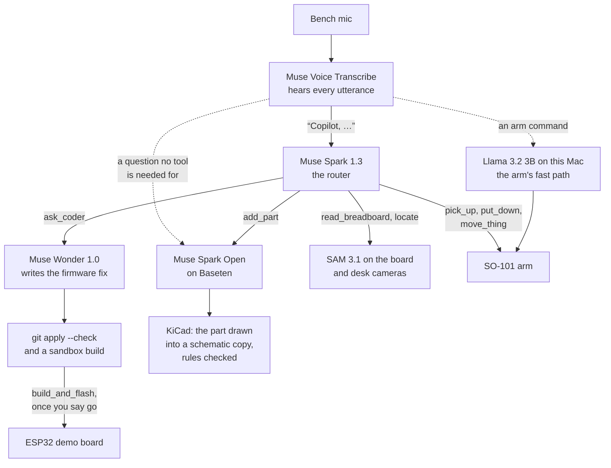
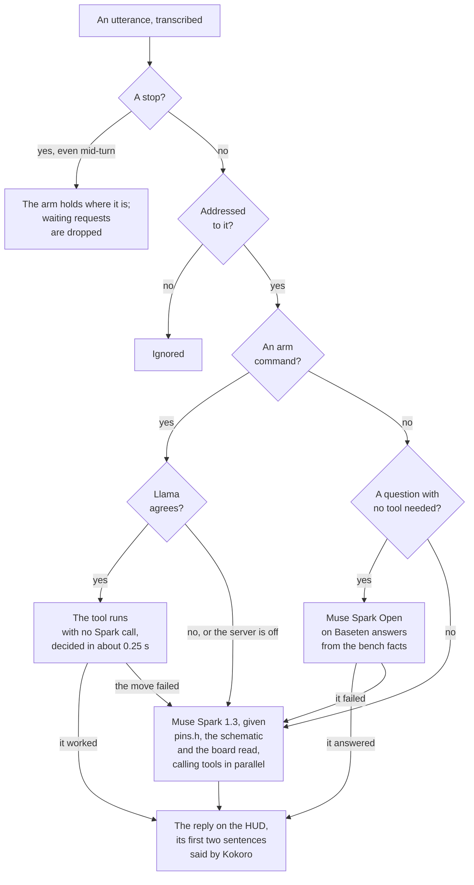

# Workbench Co-Pilot

[](https://github.com/raahimnawaz/workbench-copilot/actions/workflows/tests.yml)

An AI lab partner for the electronics bench. You talk to it hands free: say "Copilot," and your request. **Muse Spark** routes each request: **Muse Wonder** writes the firmware fix, **SAM 3.1** reads the breadboard and finds things on the desk, **Muse Voice Transcribe** hears you, and an **SO-101** arm picks things up, puts them away and holds things for you. Spoken arm commands run through a local **Llama 3.2 3B** fast path, and the HUD shows every model at work.

Built for the Meta Global AI Developer Hackathon (Indie track, Push the Frontier), Oct 26 – Nov 4, 2026.

## How it fits together



Every reply shows on the HUD, and Kokoro says it on this Mac. The dashed lines are the two routes that skip Spark; [how the router works](#how-the-router-works) gives the rules.

## Results

Over the build, API costs came down by up to 75%, and the time spent waiting on models by about 90%. The changes behind them:

- **The whole conversation in every Spark call,** instead of chaining calls on `previous_response_id`: a follow-up call went from 12–14 s to about 2 s.
- **Bench facts gathered by code, kept locally and sent up front.** Before Spark's first call of a turn, code fetches `pins.h`, the schematic and the board read in parallel, so Spark doesn't spend a round asking for them. The board read and the schematic are made once at start-up and kept for the session, so later turns pay for neither the photo nor SAM.
- **Arm commands on a local model.** Plain rules and Llama 3.2 3B on this Mac, with its prompt cache, take an arm command in about 0.25 s, against about 4.4 s through Spark, and cost nothing.
- **Work started before it's needed:** the coder's sandbox is warmed at start-up (the fix compiles in about 8 s, not 14 s), the desk camera stays open so a photo doesn't wait for it to settle, and the arm powers on during the photo. Tool calls in one round run in parallel.

## Built during the hackathon, and what it builds on

Everything in this repository was written during the hackathon, starting Oct 26, 2026, and the commit history dates every change. The exceptions are the vendored URDF and the two pieces of MIT-licensed code the HUD's page adapts, all listed below.

| Built here | What it does |
|---|---|
| `wbc/agent/` | The router loop on Muse Spark, its tools, `ask_coder` on Muse Wonder, the demo board's serial link, the voice front end (wake phrase, spoken stop, short answers), spoken replies, the budget guard and the console HUD |
| `wbc/agent/memory.py` | Sessions that survive a restart and a full context, and the `remember` / `recall` / `forget` notebook |
| `wbc/agent/fast_arm.py` | The arm's fast path: plain rules and a local Llama 3.2 3B have to agree on an arm command, which then runs with no Spark call |
| `hud/`, `wbc/agent/web_hud.py` | The HUD's orb page (canvas and WebGL, no packages) and its live feed over Server-Sent Events: the mic listening, each request, every model call with its time, the reply and its speech, and each turn's time and spend. `hud/CREDITS.md` lists what the page borrows |
| `wbc/motion/kinematics.py` | URDF chain loader, forward kinematics, damped least-squares IK, the (x, y, z, pitch, roll) grasp frame |
| `wbc/motion/joints.py`, `wbc/motion/trajectory.py` | Raw servo ticks to the URDF's joint angles, with signs checked by hand on the arm, and quintic moves timed under joint and tip speed caps |
| `wbc/motion/arm.py`, `wbc/motion/sts.py` | The arm driver, the one owner of the servo bus: power-on without a jump, moves in URDF angles, refusals before anything moves, every motor cut when a joint strays, re-aim, grip and release. And a small STS3215 client for the read-only tools |
| `wbc/motion/hand.py`, `wbc/motion/table.py` | Picking a thing up and putting it down: every pose solved before the first one moves, the fixed jaw beside the thing, and floors from the desk as the arm measured it |
| `wbc/motion/carrier.py`, `scripts/register_arm.py` | Registering the arm to the carrier from points touched with the motors off, and the touch test |
| `wbc/perception/` | The SAM 3.1 client, camera capture, the board reader (the carrier's tags, the top-down view, the hole grid fit, wire tracing, the netlist and its check against `pins.h`) and the desk camera's `locate` |
| `scripts/` | The smoke test, the board reader and its carrier sheet, the desk camera, the joint map check and arm registration |
| `wbc/perception/schematic.py`, `scripts/make_schematic.py`, `hardware/*.kicad_sch` | The demo boards' KiCad schematics, drawn from KiCad's own symbols, and `read_schematic`: their nets and KiCad's electrical rules check, through `kicad-cli` |
| `wbc/agent/parts.py` | `add_part`: Muse Spark Open teaches itself a part from `parts.yaml` (its wiring to the DevKit's free GPIOs, its library and setup code, saved as a skill in `.wbc/skills/`), and the part is drawn into a copy of the schematic in `.wbc/schematics/`, kept only if KiCad's electrical rules check passes, and shown in KiCad with `--show` |
| `scripts/kokoro_server.py`, `scripts/kokoro-say` | The co-pilot's voice: Kokoro-82M kept loaded on this Mac, and a stand-in for `say` that plays its audio |
| `config/`, `fixtures/`, `tests/` | Model, bench and arm config, the recorded bench for `--sim`, 875 offline tests |
| `firmware/dut_demo/` | Act 1's demo board: blinks an LED and logs each blink over serial |

| Reused | License | Used for |
|---|---|---|
| `hardware/so101_new_calib.urdf`, from [TheRobotStudio/SO-ARM100](https://github.com/TheRobotStudio/SO-ARM100) | Apache-2.0 | The arm's kinematic chain (unchanged copy) |
| [LeRobot](https://github.com/huggingface/lerobot) | Apache-2.0 | Servo calibration and the Feetech bus |
| The dot lattice from [thinking-orbs](https://github.com/Jakubantalik/thinking-orbs) | MIT | The orb's rings of dots in `hud/orb-light.html`, adapted to turn on the Siri line and ride our own waves (the notice is at the end of the page) |
| The bloom and sun rays from [WebGL-Fluid-Simulation](https://github.com/PavelDoGreat/WebGL-Fluid-Simulation) | MIT | The light streaming from the orb's dots in `hud/orb-light.html`, adapted to carry the dots' colors (the notice is at the end of the page) |
| Muse Spark, Muse Wonder, Muse Voice Transcribe, SAM 3.1 on the Meta Model API | Meta API terms | Routing, coding, speech, segmentation |
| [meta-sam-parser](https://pypi.org/project/meta-sam-parser/) 0.1, from Meta | SAM License | Reading SAM 3.1's replies: the token grammar and the mask codec (installed from PyPI, not vendored) |
| Llama 3.2 3B Instruct, 4-bit MLX (`mlx-community/Llama-3.2-3B-Instruct-4bit`), served by mlx-lm | Llama 3.2 Community License, and MIT for mlx-lm. **Built with Llama** | The arm's fast path: a second opinion on spoken arm commands, on this Mac |
| Muse Glimmer 30B weights | Apache-2.0 | The local backup router |
| [AprilTag](https://april.eecs.umich.edu/software/apriltag)'s tag36h11 family, as built into OpenCV's ArUco module | BSD-2-Clause | The carrier's and the desk's tags |
| [Kokoro-82M](https://huggingface.co/hexgrad/Kokoro-82M) weights, run by [kokoro-onnx](https://github.com/thewh1teagle/kokoro-onnx) with onnxruntime and espeak-ng (through espeakng-loader and phonemizer) | Apache-2.0; MIT; MIT; GPL-3.0 (espeak-ng, phonemizer) | The co-pilot's voice (Meta's API has no text-to-speech model), in its own venv: `pip install kokoro-onnx==0.6.1` |
| macOS `say` | Part of macOS | The voice only when `mouth.command` is unset: its voices can't be in a published video |
| [KiCad](https://www.kicad.org) 10 and its symbol libraries | GPL-3.0; CC-BY-SA-4.0 with KiCad's exception for designs | `kicad-cli` exports the schematics' netlists and runs their electrical rules checks; the symbols are drawn into `hardware/*.kicad_sch` |
| Muse Spark Open (`meta-models/muse-spark-open-1026`) on [Baseten](https://www.baseten.co) | Meta's open weights, served by Baseten | Questions no tool is needed for (`open` in `models.yaml`) |
| openai, numpy, PyYAML, httpx, sounddevice, pyserial, pytest, OpenCV, Pillow | Apache-2.0, BSD-3, MIT, BSD-3, MIT, BSD-3, MIT, Apache-2.0, MIT-CMU | Python dependencies |
| [PlatformIO](https://platformio.org) and the [Arduino core for ESP32](https://github.com/espressif/arduino-esp32) | Apache-2.0, LGPL-2.1 | Building and flashing the demo board's firmware |

## Status

| Piece | State |
|---|---|
| Act 1, spoken | Runs live on the real bench with the HUD: the board read, the wire on the wrong GPIO against `pins.h`, Wonder's fix staged and compiled in about 21 s from the request, then the flash on "go". |
| Router on Muse Spark | Runs live. Each call sends the whole conversation, about 2 s a call, where chaining on `previous_response_id` took 12–14 s. |
| `ask_coder` on Muse Wonder | Runs live: a fix in 3–7 s, then a warm compile in a sandbox copy in 6–8 s. |
| Voice | The wake phrase runs live on the bench mic, from Terminal.app, and replies are spoken by Kokoro-82M on this Mac (0.3 s for a short line, 0.9 s for two sentences). The spoken stop and the short answer after a question are tested on synthetic audio. |
| Memory | Runs live on `--sim`: a `--resume` run answers from the turn before it, and a new session puts the screwdriver away from a note. |
| HUD | Runs live with `--hud`, every model call under its own name with its time. Still to come: the board view, the netlist and the diff. |
| Arm fast path | Live against `mlx_lm.server`: an arm command in about 0.25 s from request to reply, against about 4.4 s through Spark. On 117 phrasings neither was tuned on, rules and model agreeing never moved the arm wrongly. |
| Arm driver | Runs on the real arm: power-on without a jump, moves at up to 45°/s and 180 mm/s, every motor cut on a stray. |
| Picks and puts | Run on the real arm by voice: "put my screwdriver on my sticky note" worked in 4 of its last 6 tries, the quickest 31.5 s from the request. The other two: the wrist roll's stop, which moves keep clear of now, and a note out of reach straight down. "Put my screwdriver in my cup" stood it in the mug on end, handle first, in 43 s. |
| Board reader | Runs live: it reads the flat wires, traces the nets, and reports a wire on the wrong GPIO with the line to fix. |
| Schematic | Runs at start-up: `read_schematic` gives the LED board's nets and a clean electrical rules check in under 1 s, and Spark and Spark Open get them with the board read. Spark Open's answer below came from them. |
| Spark Open | Runs live on Baseten: a question no tool is needed for goes to Spark Open with the bench facts, which answered "what should I read on GPIO4 when the LED is on?" from the schematic and the firmware in 7.4 s; anything else, or a failure, goes to Spark. |
| Add a part | Ran live on Baseten against the LED board's schematic: Spark Open worked out the screen's wiring in 8.7 s on its first try (the ESP32's hardware SPI pins for the clock and data, free GPIOs for the rest), and KiCad's check passed on the drawn copy, about 1¢ a run. Not in a take yet. |
| Desk camera and `locate` | Runs live: a screwdriver or a sticky note found on the desk and placed in the arm's frame. |
| FK/IK and the joint map | 200 of 200 bench poses round-trip within 0.2 mm and 0.5°. All five joint signs checked by hand on the arm. |
| Budget guard | Every paid call checks tracked spend first. |

## Setup (Apple Silicon)

```bash
uv venv --python 3.12 && source .venv/bin/activate
uv pip install -e '.[voice,dev]'
cp .env.example .env        # then put your META_API_KEY in .env
pytest
python scripts/smoke_test.py
```

The smoke test makes one small call to each hosted model and reports which model ids your key can see. Run it before anything else. The arm needs the `arm` and `lerobot` extras, the cameras `eyes`, and flashing the demo board `firmware`.

## Run

```bash
python -m wbc.agent --sim
```

Then type `My LED isn't blinking. Check my wiring against the firmware.` With `--sim`, `read_breadboard` returns the recorded Act 1 scene from `fixtures/`, and `build_and_flash` pretends. That runs the real router and the real Wonder coder with no hardware attached.

- `--voice` also listens on the bench mic (`ears.input_device`). Say "Copilot," and your request, or "Copilot." and then the request. Every utterance is transcribed, and only the ones addressed to the co-pilot go to the router. After a reply that asks something, a short answer such as "Yes." or "Go." needs no "Copilot," for 8 s. `--hear` is a mic check: it prints what it heard and routes nothing. The first time, macOS asks to let your terminal use the microphone.
- With `--voice`, replies are said out loud: the first sentence or two of each, while the HUD shows all of it. The mic drops what it hears while the co-pilot speaks, so it never answers itself. `--no-speak` keeps replies on the HUD, and `--speak` says them without `--voice`. The voice is Kokoro-82M on this Mac: install it in a venv of its own with a short path (`python3 -m venv ~/kokoro-venv && ~/kokoro-venv/bin/pip install kokoro-onnx==0.6.1`), and leave `~/kokoro-venv/bin/python -I scripts/kokoro_server.py` running (`--models` names the folder with kokoro-onnx's v1.0 model files). `mouth:` in `config/models.yaml` picks the voice (the server's `/voices` lists them).
- `--hud` shows each turn live on the HUD's orb page: open <http://127.0.0.1:8766/> in Chrome (`--hud 8800` picks another port). `hud/README.md` has the details.
- `--show`, for a take on macOS, opens the HUD (with `--hud`) as a Chrome app window of its own, with no tabs or address bar, and the board's schematic in KiCad's Schematic Editor. The window closes when the agent ends (`wbc/agent/show.py`).
- `--arm` lets the arm's tools move it. With `hand.go_ahead: request` in `config/robot.yaml`, your request is the go-ahead and the arm moves at once. "Copilot, stop", or "Stop!" on its own, goes straight from the ears to the arm, even mid-turn: it holds where it is with its motors on, and the requests waiting behind it are dropped. `--enter` makes each move wait for Enter at the keyboard, for bench tests. Ctrl-C cuts every motor and the arm drops, so keep a hand near it. `--no-prefetch` skips Act 1's board checks in a session that only moves the arm.
- Arm commands can skip Spark. Serve Llama 3.2 3B on this Mac in its own venv: `pip install mlx-lm==0.32.2`, then `mlx_lm.server --model mlx-community/Llama-3.2-3B-Instruct-4bit --port 8090 --prompt-cache-bytes 536870912` (the first run downloads 1.8 GB). While it runs, a request naming a thing and a place the rules know (`fast_arm:` in `config/models.yaml`) runs at once if Llama agrees on the kind of command, and the result is said when the move is done. Everything else goes to Spark with no extra wait. `--no-fast-arm` sends everything to Spark, to compare.
- Every turn is recorded in `.wbc/session.json`, however it ends. Each run starts a new session; `--resume` picks up the last one, and `--sim` keeps its own. A conversation that grows too long, or fails twice in a row, becomes a summary that the next one starts from, and code never runs a tool twice: after a tool has run, it asks what's still to do. The turns a summary folds away are kept, and a request that mentions one brings it back whole, with the exchange around it, in that turn's own message, so "which pin was the LED on earlier?" finds the turn that said so while the instructions stay the same from turn to turn. Matches are scored by BM25 (a rare word counts most, whole words only, evened out for length), by age at 1 / ln(e + age) for up to half, so an old match fades slowly instead of falling off, and by what the turn did: one that changed the bench counts 1.5 times talk. Past the newest 20 notes, an old note the request is about reaches its turn the same way. With `memory.embeddings` set to an OpenAI-compatible embeddings server, matches by meaning join the word matches by reciprocal rank fusion. Spark Open sees the last six turns, so a question can refer back to them.
- The router keeps a notebook in `.wbc/notebook.jsonl` with its `remember`, `recall` and `forget` tools, and the newest 20 notes go into every call. A note can say where a thing goes on the desk, with the short name `locate` should look for in quotes (the screwdriver goes on the "sticky note"), so "put the screwdriver away" works in a later session. A note never moves the arm by itself.
- `--backup` routes with Muse Glimmer on your own machine, through any OpenAI-compatible server that supports tool calls (llama.cpp's `llama-server`, LM Studio or Ollama): set `backup.base_url` and `backup.model` in `config/models.yaml`.

## How the router works

Every utterance is transcribed, and each one takes the first path that fits:



- **A stop** is "Copilot, stop", or "Stop!" on its own. It's heard while a turn runs and while the co-pilot speaks, and goes straight to `Bench.halt()`.
- **Addressed to it** means it starts with "Copilot", or answers the co-pilot's question in up to five words within 8 s.
- **An arm command** is found by plain rules (`wbc/agent/fast_arm.py`): its kind from trigger words, its thing and place from `fast_arm` in `config/models.yaml` or a note's quoted place. Questions, a "not", "I" and "we" statements, a bare "that" and unknown things aren't. Llama 3.2 3B on `mlx_lm.server` then has to name the same kind of command.
- **A question with no tool needed** starts with "what", "how", "is" and the like, and has none of "why", "fix", "flash", "move" and the rest, nor anything only the cameras, the arm, the notebook, the spend or the conversation can answer ("where", "holding", "cup", "earlier", "spent"…). When the bench facts don't answer it after all, Spark Open replies PASS and Spark takes it; a Baseten call that stalls gives up after 20 s, with no retry, and Spark takes it too.

Once a request reaches Muse Spark, it decides what runs, and every other model sits behind a tool:

- Before Spark's first call of a turn, code fetches the bench facts it will need (`router.prefetch`): `pins.h`, the schematic, and the board read, which is made once at start-up and kept for the session. Spark calls `read_breadboard` itself when you say the wiring changed.
- `ask_coder` sends a task, the bench facts and up to 4 files to Muse Wonder. The diff it returns must pass `git apply --check` and a PlatformIO build in a sandbox copy, and then it's staged in the working tree, never committed. A diff that fails either check goes back to Wonder once with the error and the build log, inside the same call, so Spark doesn't spend a round asking again. `build_and_flash` uploads it to the demo board once you say go, and Spark asks whether the LED blinks.
- Tool calls in one round run in parallel. Every model id and price lives in `config/models.yaml`.
- **Budget stop:** every paid call checks tracked spend first. Nothing more goes out once it reaches `budget.limit_usd` ($140, just under the $150 credit), and the HUD warns once past `budget.warn_usd` ($100). Tracked spend lives in `.wbc/spend.json` and uses the estimated prices in `models.yaml`. Calls made elsewhere aren't counted, so keep the spend alert on the Meta Billing page as the backstop.

## Reading the breadboard

`read_breadboard` turns one photo into each jumper's two holes, the netlist, and every place it disagrees with `pins.h`:

1. **Tags.** The breadboard lies on a printed carrier sheet with four AprilTags (tag36h11, ids 10–13, 20 mm). Their corners map the photo onto the sheet in millimeters, so a bumped camera or a refocus doesn't move the hole grid, and there's no camera calibration to keep.
2. **Top-down view.** Code cuts out the board area at 5.5 px/mm, about 970 × 360 px. That's under the 1008 px SAM works at, so thin wires keep their detail, and SAM's masks come back in board millimeters.
3. **SAM 3.1 and the hole grid.** SAM segments `wire` in the view: one plain noun per request, since "jumper wire" matches nothing. Meanwhile code finds where the board really lies: it shifts, turns and scales the hole grid, within half a pitch, until the predicted holes sit on the darkest spots. The board's top stands about 10 mm above the sheet, so the camera sees it about 2% larger than life, and only the right scale lines up all 63 rows.
4. **Wires.** Each mask is thinned to its center line and followed out to both tips. Each tip snaps to the nearest hole within 1.3 mm, and a tip farther from every hole is flagged.
5. **Netlist and `pins.h`.** Each row's a–e and f–j strips and each rail is a node, wires join nodes, and the ESP32's and the LED's pins sit in holes given in `config/bench.yaml`. Plain code follows each `pins.h` signal from its part's pin to the GPIO its net reaches, and reports any mismatch, its wire and hole, and the line to fix.

**The Act 1 board** is an ESP32 DevKit blinking an LED: one jumper from the DevKit's header to a row, 330 Ω from that row to the LED's anode, and the LED's cathode to ground. The DevKit straddles the center channel, which leaves only column a free beside its pins, so the board carries one signal wire. Watch its blinks with `.venv/bin/pio device monitor -b 115200`. A force sensor board on the same jumper (`hardware/demo_sensor.kicad_sch`) is what `read_sensor` reads. The reader reads flat pre-cut jumpers: loose leads stand about 15 mm off the board, and their tips look up to 4 mm from where they go in.

```bash
python scripts/make_carrier.py          # .wbc/vision/carrier.pdf: print at 100%, check the 100 mm bar
python scripts/read_board.py cameras    # free: which cameras macOS and OpenCV see
python scripts/read_board.py check      # free: the tags, and the fitted hole grid drawn over the board
python scripts/read_board.py read       # $0.0025: the whole read, drawn in .wbc/vision/board-<time>.png
```

- Run them from Terminal.app, which macOS lets use the camera. Each takes a still from the camera in `bench.yaml`, or reads one with `--photo`. The C920 refocuses every time it's opened, so the capture waits 1.5 s, then keeps the sharpest of the next 1.5 s of frames.
- `config/bench.yaml` holds the camera, the carrier's tags, each board's place on the sheet, where each module's headers start, and which part pin each `pins.h` signal drives. `config/parts.yaml` holds the breadboard's geometry and the module pinouts. Change those and print the carrier again; never edit the sheet.
- Each read checks its own photo: a blurred top-down view (sharpness under 150, where good reads measured 389–556) or glare that blows out more than 1% of it is said among the read's problems, with what to change ("move the lamp"), and the read goes ahead.
- Each read saves the drawing, the top-down view and the result, with SAM's whole reply, as `.wbc/vision/board-<time>.*`.

## Finding things on the desk

A second C920 looks straight down at the desk from about 71 cm and sees the arm's whole reach, about 97 × 55 cm at 0.5 mm per pixel. `wbc/perception/desk.py` turns what it sees into the arm's frame, so the co-pilot can find "the cup" or "the screwdriver" and know where it is.

1. **Tags, touched once.** AprilTags (tag36h11, ids 20–25, 50 mm) lie flat around the arm's reach. The carrier's 20 mm tags can be touched too, so the arm over a few of the desk's still leaves enough in view. With the motors off, you put the gripper's tips on each tag's center, and forward kinematics records where it is in the arm's frame. Every photo is mapped through the tags it shows, so a bumped camera changes nothing.
2. **Top-down view and SAM 3.1.** Code cuts out the table around the arm at 1 px/mm and asks SAM for the thing by name.
3. **Height.** Something standing up looks further from the point under the camera than it is. The tags also place the camera itself, so given a thing's height, its outline's near and far edges put its middle back where it is: a cup's middle lands within 3 mm.

```bash
python scripts/desk_camera.py tags                                    # .wbc/vision/desk-tags.pdf: print at 100%
python scripts/desk_camera.py --port /dev/cu.usbmodemXXXX touch       # motors off: touch each tag's center
python scripts/desk_camera.py check                                   # free: how well the tags agree
python scripts/desk_camera.py table                                   # free: the desk's height under the arm, from the touches
python scripts/desk_camera.py locate cup --height 95                  # $0.0025: where the cup is in the arm's frame
```

`config/desk.yaml` holds the camera, the tags, the area SAM sees and the focal length used to place the camera.

## The arm

`wbc/motion/arm.py` is the driver, and the only code that talks to the servo bus while the agent runs. `Arm.open()` connects LeRobot's bus and nothing more: never `robot.connect()`, which can recalibrate the arm and always ends by turning torque on. `power_on()` brings the joints up one at a time from the base out, and `move_to(q)` moves all five together to URDF angles q.

- **Refused before anything moves:** a joint past an end of its calibrated range, the wrist roll near where its reading wraps, a servo at 65 °C, a target within 2° of a range's end, and a path that takes the jaw tips under their floor or the elbow and wrist axes under 30 mm above the desk. A refusal says which joint and which way to turn it.
- **Speed:** moves are quintic and peak at 45°/s on any joint and 180 mm/s at the jaw tips, and no goal goes more than 5° from where its joint is. Torque is capped at 50% on the arm joints and on the gripper (LeRobot's own ceiling for it; the gripper's overload threshold, which LeRobot sets to 25%, goes to 60% while it's powered, or a 50% squeeze would drop to 20% after 2 s), and a P of 32 on every joint but the wrist roll goes back on after LeRobot's setup at every power-on.
- **Cuts:** every motor is cut at once if a joint jumps 3° as its torque comes on, strays 5° from its goal during a move, sags 5 mm under a floor, or the bus fails. `cut()` works from any thread or a signal handler, every cut is read back servo by servo, and a cut latches until `clear_stop()`. `halt()`, the spoken stop, stops a move at its next tick and holds the arm there with its motors on.
- **Re-aim:** each joint stops short of its goal by its load over its P gain, so after a move's path `move_to()` sets each goal past its target by the shortfall, under the same caps and checks, until every joint is within 0.2°.
- **Gripper:** `grip()` closes on what's between the jaws and keeps squeezing under the cap, and says whether they stopped on something. `release()` opens them, stopping where something's in the way.

`wbc/motion/hand.py` builds the agent's arm skills on the driver. A pick goes straight down beside a thing's grip, 1 cm from its middle toward its narrow end (on a screwdriver, the handle near where it balances), with the jaws closing across its long axis, the fixed jaw beside it and the moving jaw closing it against the fixed one: over it, open only as wide as it needs, just over its top, down, grip, and back up. These jaws hold a handle in the gap above their tips, reading as shut as empty ones, so a pick goes back up either way and says when it can't tell. A put lines what's held up with the place's long axis, goes down to just over its top, opens as wide as the pick did, and closes the jaws again back up. A put into a container (`hand.containers` in `config/robot.yaml`, with its measured height) stands what's held in on end instead: lifted with the jaws turned across the arm, so turning the gripper up stands it on end over the opening, its narrow end first where the wrist roll can turn it that way, then down until that end is 15 mm inside the rim, and let go. The gripper reaches level low enough from about 25–28 cm out. Every pose a pick or a put needs is solved before the first one moves, so one the arm can't reach is refused with the arm where it was. Heights come from the desk as the arm's touches measured it (`wbc/motion/table.py`). Between requests, empty-handed, the arm waits in an idle pose with its motors on: the L pose with the gripper pointing straight down (`hand.idle_deg` in `config/robot.yaml`). The end of a session takes it back to where it sat when its motors came on, since the L pose can't hold itself up unpowered, and then the motors go off.

```bash
python scripts/check_joint_map.py --port /dev/cu.usbmodemXXXX check   # motors off: the joint map's signs, by hand
python scripts/register_arm.py --port /dev/cu.usbmodemXXXX touch       # motors off: register the arm to the carrier
```

- The joint map is q = sign · (raw − 2047) · 2π / 4096, with every sign +1: lerobot-calibrate's L pose is the URDF's zero. `check_joint_map.py` repeats the hand test, so run it again after a recalibration or a servo swap. It only reads, and won't run with a motor on.
- Keep to one program per serial port: LeRobot opens the port without locking it, so two would interleave their packets.
- In the URDF the gripper approaches along its z-axis, and `config/robot.yaml` turns the tool frame so the approach is x and the tool point is the closed jaws' tips.
