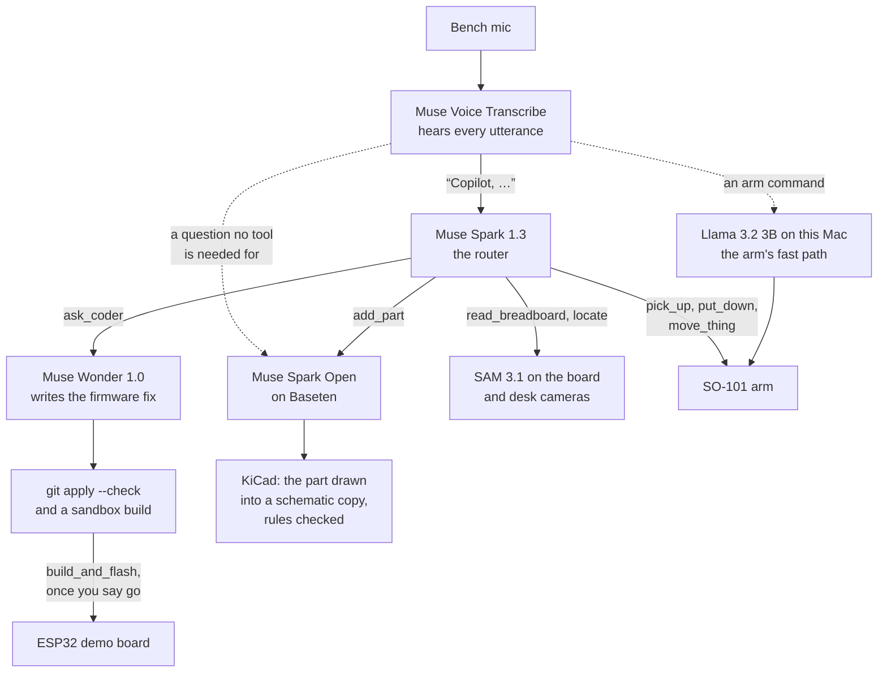

# Workbench Co-Pilot

[](https://github.com/raahimnawaz/workbench-copilot/actions/workflows/tests.yml)

A voice-driven lab partner for the electronics bench. It looks at a breadboard through a camera, finds the miswired pin, fixes and flashes the firmware, and uses an SO-101 robot arm to pick up tools and put them away. Your hands stay on the bench.

Built in ten days (Oct 26 – Nov 4, 2026) for the Meta Global AI Developer Hackathon, Indie track, Push the Frontier.

## What it does

- **Debugs the wiring.** One photo of the breadboard becomes a netlist: AprilTags map the photo to millimetres, SAM 3.1 segments the jumpers, and code fits the hole grid and traces each wire to its holes. The netlist is checked against the firmware's `pins.h`, and the mismatch comes back as the wire, the hole and the line to change.
- **Fixes the firmware.** A coding model writes the fix as a diff. It must apply and compile in a sandbox before it's staged, and it's flashed to the ESP32 only when you say "go".
- **Moves things with the arm.** "Put my screwdriver in my cup": a second camera finds the screwdriver and the cup in the arm's frame, inverse kinematics plans every pose of the pick and the put before the first move, and the arm stands the screwdriver in the cup.
- **Extends the circuit.** "Add my screen": a model wires a new part to free GPIOs and draws it into the KiCad schematic, which is kept only if KiCad's electrical rules check passes.

## What I built

The models are hosted. The engineering around them is in this repo: about 20,000 lines of Python, tests included, with 908 offline tests in CI.

- **Arm control and safety** ([docs/arm.md](docs/arm.md)). The SO-101 driver: URDF kinematics, damped least-squares IK, quintic minimum-jerk moves under joint and tip speed caps, and per-joint re-aim to 0.2°. Unsafe moves are refused before anything moves (joint limits, temperature, a path under the desk), every motor is cut if a joint strays 5° or the bus fails, and a spoken "stop" holds the arm mid-move.
- **Perception** ([docs/perception.md](docs/perception.md)). Breadboard reading from one photo, with no camera calibration to maintain; desk localisation with height correction, so a cup's centre lands within 3 mm; and a sharpness and glare check that says how to fix a bad photo.
- **A local fast path for arm commands** ([docs/agent.md](docs/agent.md)). Plain rules propose an arm command and Llama 3.2 3B, running on the Mac, can only veto it. Neither alone is safe enough: on 117 phrasings neither was tuned on, the model alone made 20 wrong moves and the rules alone 3; agreeing, they made none. I fine-tuned the local model with a LoRA after Meta's Toolformer, keeping only labels whose tool call actually ran on a recorded bench.
- **An agent loop built for latency** ([docs/agent.md](docs/agent.md)). Bench facts gathered by code before the router's first call, tool calls run in parallel, sessions that survive restarts, and a budget guard on every paid call.

## Results

| Measured | Result |
|---|---|
| Spoken arm command, request to reply | **0.25 s** on the Mac, against 4.4 s through the cloud router, at no API cost |
| Wrong arm moves on 117 unseen phrasings | **0** with rules and model agreeing (model alone: 20, rules alone: 3) |
| Inverse kinematics on bench poses | **200 of 200** round-trip within 0.2 mm and 0.5° |
| Find the miswired GPIO, write the fix and compile it | **9 s** median over 29 takes |
| Learn a new part and add it to the schematic, rules-checked | **11 s** median over 29 takes |
| Toolformer-style fine-tune, right tool on 53 held-out requests | **47 → 50**, from 351 kept labels costing $0.99 |
| Over the build | API cost down by up to 75% and time waiting on models down by about 90%; a full demo costs about $0.06 |

The timings from every take and the measurements behind each design choice are in [docs/design.md](docs/design.md).

## Research it draws on

| Idea | Source | Used for |
|---|---|---|
| Learning tool use from self-written labels | Toolformer (Schick et al., NeurIPS 2023) | The local model's fine-tune, keeping a label only when its tool call runs on the recorded bench |
| Low-rank adaptation | LoRA (Hu et al., ICLR 2022) | The fine-tune itself, on Llama 3.2 3B |
| Promptable segmentation | Segment Anything (Kirillov et al., ICCV 2023), SAM 3 | Wires on the breadboard and things on the desk, from one noun phrase |
| Fiducial markers | AprilTag (Olson, ICRA 2011) | Mapping each photo to millimetres and the desk to the arm's frame |
| Damped least-squares IK | Nakamura & Hanafusa (1986) | The arm's inverse kinematics near singularities |
| Minimum-jerk motion | Flash & Hogan (1985) | Quintic moves for every joint |
| Cheap model first, large model as fallback | FrugalGPT (Chen et al., 2023), RouteLLM (Ong et al., 2024) | The arm's fast path, with the change that two independent checks must agree |
| Parallel function calling | LLMCompiler (Kim et al., ICML 2024) | Running a round's tool calls together |
| Self-correction from feedback | Reflexion (Shinn et al., NeurIPS 2023) | One retry for a firmware diff, with the compiler's error |
| Retrieval scoring | BM25, IDF, DCG's log discount; Generative Agents (Park et al., UIST 2023) | Recalling earlier turns and notes by rare words, age and importance |
| Sharpness measure | Variance of the Laplacian (Pech-Pacheco et al., 2000) | Rejecting a blurred photo of the board |

How each one is applied, and what was measured, is in [docs/design.md](docs/design.md); full citations are under [References](docs/design.md#references).

## How it fits together



Muse Spark routes each request to a tool. The dashed lines are the two routes that skip it, for speed and cost. Replies show on a live HUD and are spoken by Kokoro on the Mac.

**Hardware:** SO-101 arm (six Feetech STS3215 servos), ESP32 DevKit on a breadboard, two Logitech C920 webcams, a USB mic and an Apple Silicon Mac. The full list is in [docs/setup.md](docs/setup.md#hardware).

## Try it without hardware

`--sim` runs the real models against a recorded bench, for about $0.025 a run on the Meta Model API.

```bash
git clone https://github.com/raahimnawaz/workbench-copilot && cd workbench-copilot
uv venv --python 3.12 && uv pip install -e '.[voice,dev]'
cp .env.example .env        # then add your META_API_KEY
echo "My LED isn't on. Check my wiring against the firmware." | .venv/bin/python -m wbc.agent --sim
```

Voice, the arm, the cameras and the HUD are covered in [docs/setup.md](docs/setup.md).

## Next

- **Stronger servos and gravity-aware planning:** 12 V STS3215s for reach with a load, and the URDF's link masses used to refuse poses a joint can't hold before the arm moves.
- **Reinforcement learning in simulation:** the URDF already carries every link's mass and inertia, so grasping odd shapes and recovering from slips can be trained in MuJoCo with domain randomisation, then fine-tuned on the arm under the driver's same safety limits.
- **V-JEPA 2** on the desk camera, to tell a held tool from empty jaws, which the servos can't.
- **ROS 2:** each skill as a node, actions for long moves, tf2 for the camera and arm frames, and MoveIt's collision checks.

More in [docs/design.md](docs/design.md#after-the-hackathon).

## Documentation

| | |
|---|---|
| [docs/setup.md](docs/setup.md) | Install, run options, hardware |
| [docs/agent.md](docs/agent.md) | The router, the arm's fast path and the fine-tune |
| [docs/perception.md](docs/perception.md) | Reading the breadboard, finding things on the desk |
| [docs/arm.md](docs/arm.md) | The arm driver, its safety checks, pick and put |
| [docs/design.md](docs/design.md) | Design notes, measured results, references |
| [docs/credits.md](docs/credits.md) | What was built here and what it reuses, with licenses |

Builds on two earlier projects, as ideas rather than code: [singularity-guard](https://github.com/raahimnawaz/singularity-guard) (the damped least-squares IK the arm uses) and [ros2-vision-nodes](https://github.com/raahimnawaz/ros2-vision-nodes) (the same perception → decision → action loop on a gesture-driven robot base).

## Author and license

Raahim Nawaz ([@raahimnawaz](https://github.com/raahimnawaz)). Apache-2.0: see [LICENSE](LICENSE). Reused pieces keep their own licenses, listed in [docs/credits.md](docs/credits.md).
