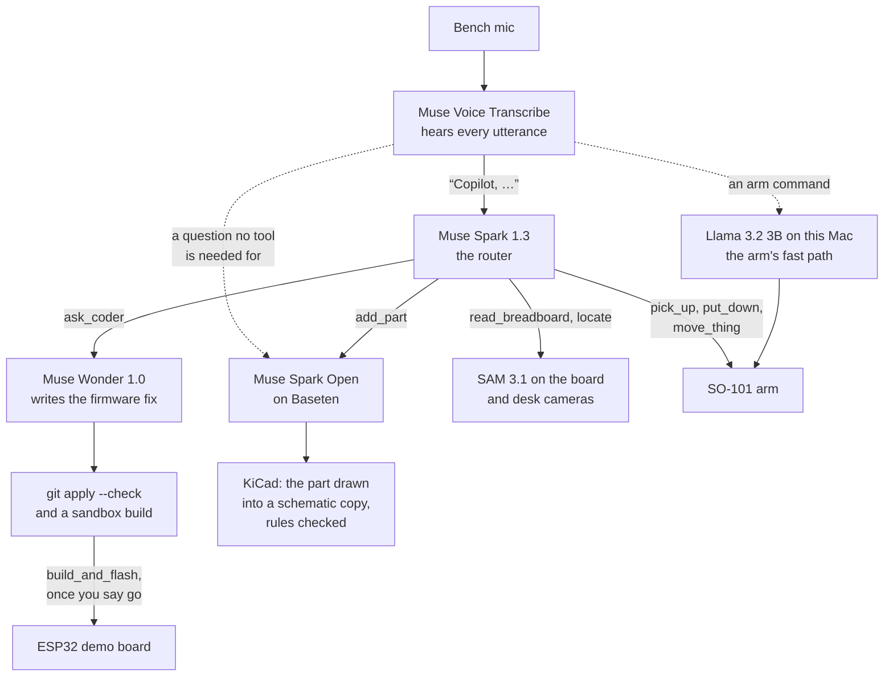

# Workbench Co-Pilot

[](https://github.com/raahimnawaz/workbench-copilot/actions/workflows/tests.yml)

A voice-driven lab partner for the electronics bench. It looks at a breadboard through a camera, finds the miswired pin, fixes and flashes the firmware, and uses an SO-101 robot arm to pick up tools and put them away. Your hands stay on the bench.

Built in ten days (Oct 26 – Nov 4, 2026) for the Meta Global AI Developer Hackathon, Indie track, Push the Frontier.

## What it does

- **Debugs the wiring.** One photo of the breadboard becomes a netlist: AprilTags map the photo to millimetres, SAM 3.1 segments the jumpers, and code fits the hole grid and traces each wire to its holes. The netlist is checked against the firmware's `pins.h`, and the mismatch comes back as the wire, the hole and the line to change.
- **Fixes the firmware.** A coding model writes the fix as a diff. It must apply and compile in a sandbox before it's staged, and it's flashed to the ESP32 only when you say "go".
- **Moves things with the arm.** "Put my screwdriver in my cup": a second camera finds the screwdriver and the cup in the arm's frame, inverse kinematics plans every pose of the pick and the put before the first move, and the arm stands the screwdriver in the cup.
- **Extends the circuit.** "Add my screen": a model wires a new part to free GPIOs and draws it into the KiCad schematic, which is kept only if KiCad's electrical rules check passes.

## What I built

The models are hosted. The engineering around them is in this repo: about 20,000 lines of Python, tests included, with 908 offline tests in CI.

- **[Arm control and safety](#arm-control-and-safety)**. The SO-101 driver: URDF kinematics, damped least-squares IK, quintic minimum-jerk moves under joint and tip speed caps, and per-joint re-aim to 0.2°. Unsafe moves are refused before anything moves (joint limits, temperature, a path under the desk), every motor is cut if a joint strays 5° or the bus fails, and a spoken "stop" holds the arm mid-move.
- **[Perception](#perception)**. Breadboard reading from one photo, with no camera calibration to maintain; desk localisation with height correction, so a cup's centre lands within 3 mm; and a sharpness and glare check that says how to fix a bad photo.
- **[A local fast path for arm commands](#the-arms-fast-path)**. Plain rules propose an arm command and Llama 3.2 3B, running on the Mac, can only veto it. Neither alone is safe enough: on 117 phrasings neither was tuned on, the model alone made 20 wrong moves and the rules alone 3; agreeing, they made none. I fine-tuned the local model with a LoRA after Meta's Toolformer, keeping only labels whose tool call actually ran on a recorded bench.
- **[An agent loop built for latency](#an-agent-loop-built-for-latency)**. Bench facts gathered by code before the router's first call, tool calls run in parallel, sessions that survive restarts, and a budget guard on every paid call.

## Results

| Measured | Result |
|---|---|
| Spoken arm command, request to reply | **0.25 s** on the Mac, against 4.4 s through the cloud router, at no API cost |
| Wrong arm moves on 117 unseen phrasings | **0** with rules and model agreeing (model alone: 20, rules alone: 3) |
| Inverse kinematics on bench poses | **200 of 200** round-trip within 0.2 mm and 0.5° |
| Find the miswired GPIO, write the fix and compile it | **9 s** median over 29 takes |
| Learn a new part and add it to the schematic, rules-checked | **11 s** median over 29 takes |
| Toolformer-style fine-tune, right tool on 53 held-out requests | **47 → 50**, from 351 kept labels costing $0.99 |
| Over the build | API cost down by up to 75% and time waiting on models down by about 90%; a full demo costs about $0.06 |

The timings from every take and the measurements behind each design choice are in [docs/design.md](docs/design.md).

## How it fits together



Muse Spark routes each request to a tool. The dashed lines are the two routes that skip it, for speed and cost. Replies show on a live HUD and are spoken by Kokoro on the Mac.

**Hardware:** SO-101 arm (six Feetech STS3215 servos), ESP32 DevKit on a breadboard, two Logitech C920 webcams, a USB mic and an Apple Silicon Mac. The full list is in [docs/setup.md](docs/setup.md#hardware).

## Arm control and safety

`wbc/motion/arm.py` is the arm's driver and the only code that talks to the servo bus while the agent runs. Everything below happens on the Mac, with no model in the loop.

**Kinematics.** The SO-101's chain is loaded from its URDF for forward kinematics. Inverse kinematics is damped least squares, which stays well behaved near singularities where a plain Jacobian inverse blows up, and solves for a five-number grasp frame: x, y, z, pitch and roll, with the tool point at the closed jaws' tips. Raw servo ticks map to the URDF's joint angles as q = (raw − 2047) · 2π / 4096, with every sign checked by hand on the arm. On 200 bench poses, IK and forward kinematics round-trip within 0.2 mm and 0.5°.

**Motion.** Every move is a quintic, the minimum-jerk profile, timed so no joint passes 45°/s and the jaw tips stay under 180 mm/s. No goal is sent more than 5° from where its joint is, and torque is capped at 50%. A position-controlled servo under load stops short of its goal by its load over its P gain, so after each path the driver aims each joint past its target by the shortfall, for up to three rounds, until every joint is within 0.2°.

**Refused before anything moves.** Every pose of a pick and a put is solved before the first one moves, so a move the arm can't finish never starts. A plan is refused, with the joint and the direction to turn it, when it would take a joint past its calibrated range, put the wrist roll near where its reading wraps, ask a servo at 65 °C to work, aim within 2° of a range's end, or bring the jaw tips under their floor or the elbow and wrist axes within 30 mm of the desk. The floor isn't a guess: the arm measures the desk by touching printed tags with its motors off.

**Cut while moving.** Every motor is cut at once if a joint jumps 3° as its torque comes on, strays 5° from its goal during a move, sags 5 mm under a floor, or the bus fails. A cut works from any thread or a signal handler, is read back servo by servo, and latches until it's cleared.

**Stopped by voice.** "Copilot, stop", or "Stop!" on its own, goes straight from the speech front end to the arm, even mid-turn and while the co-pilot is speaking. The arm holds where it is with its motors on, and the requests queued behind it are dropped.

More in [docs/arm.md](docs/arm.md).

## Perception

Two C920 webcams and SAM 3.1, with plain geometry doing the rest.

**Reading the breadboard from one photo.** The breadboard lies on a printed sheet with four AprilTags, and their corners map the photo onto the sheet in millimetres. A bumped camera or a refocus changes nothing, and there's no camera calibration to maintain.

1. Code cuts out a top-down view of the board at 5.5 px/mm, about 970 × 360 px, under the 1008 px SAM works at, so thin wires keep their detail.
2. SAM 3.1 segments the wires from one noun phrase. Meanwhile code fits the board's hole grid to the photo, shifting, turning and scaling it within 1.2 mm, 1° and 0.97–1.06 until the predicted holes sit on the darkest spots. The scale matters: the board's top stands about 10 mm above the sheet, so it looks about 2% larger than life, and only the right scale lines up all 63 rows.
3. Each wire mask is thinned to its centre line and followed to both tips, and each tip snaps to the nearest hole within 1.3 mm.
4. The strips and rails become nodes and the wires join them into a netlist. Code follows each signal in the firmware's `pins.h` from its part's pin to the GPIO its net reaches, and reports any mismatch with its wire, its hole and the line to change.

A read costs $0.0025.

**Finding things on the desk.** A second camera looks down from 71 cm and sees the arm's whole reach, about 97 × 55 cm at 0.5 mm per pixel. To tie it to the arm, you touch the gripper's tips to each desk tag once with the motors off, and forward kinematics records where each tag is in the arm's frame. Every photo is then mapped through whichever tags it shows. Something standing up looks further from the point under the camera than it is, so the tags also place the camera itself, and given a thing's height, the near and far edges of its outline put its middle back where it is: a cup's centre lands within 3 mm. A pick aims 1 cm from a thing's middle toward its narrow end, such as a screwdriver's handle near where it balances.

**A photo the read can trust.** The C920 refocuses every time it opens, so capture keeps the sharpest frame from a short window. Each read then scores its own view's sharpness as the variance of the Laplacian (good reads measured 389–556; under 150 is flagged) and how much of it glare blew out, and says what to change, such as "move the lamp".

More in [docs/perception.md](docs/perception.md).

## The arm's fast path

A spoken arm command shouldn't wait four seconds on a cloud model, and a small local model shouldn't be trusted to move an arm on its own. So two independent checks have to agree.

**The rules propose; the model can only veto.** Plain rules (`wbc/agent/fast_arm.py`) take the kind of command from its trigger words ("put", "pick up", "go home") and the thing and place from the names in config, or from where a saved note says a thing goes. Questions, negations, "I" and "we" statements, a bare "that", unknown things, and requests with more than one command in them aren't taken; they go to the cloud router whole. Llama 3.2 3B, 4-bit on `mlx_lm.server` on the Mac with its prompt cache, then reads the same request and must name the same kind of command. It never supplies a name, so it can't send the arm anywhere the rules didn't find. A move that fails goes to the router to explain.

| On 117 phrasings neither side was tuned on | Wrong arm moves |
|---|---|
| Llama 3.2 3B alone | 20 |
| Rules alone | 3, each now caught by a rule |
| Rules and model agreeing | **0** |

49 of the 62 real commands ran locally, in about 0.25 s from request to reply against about 4.4 s through the router, at no API cost.

**Fine-tuning the local model, after Toolformer.** Meta's Toolformer teaches a model a tool from labels it writes itself, keeping a call only when it lowers the model's loss. Here the large model teaches the small one, and a label is kept only when its call actually works:

1. The router model writes varied spoken requests for 13 intents, including the ones that only sound like arm commands ("I put…", "don't…", idioms, wiring requests).
2. It labels each request in the fast path's own prompt and bench state.
3. A label is kept only if it matches the intent it was written for and its tool call runs on the recorded bench; a `put_down` labelled while nothing is held fails there and is dropped. Every phrasing in the benchmark is held out.
4. A LoRA (rank 8, alpha 16, on `q_proj` and `v_proj`, loss on the answer only, 3 epochs at 2e-4) trains on one A10G on Modal, and its adapter is converted into the layout `mlx_lm.server` loads.

351 of 390 labels were kept, for $0.99. The right tool on 53 held-out requests went from 47 to 50, and an answer with the adapter takes 0.18 s at the median.

More in [docs/agent.md](docs/agent.md#the-arms-fast-path-rules-llama-and-a-toolformer-style-fine-tune).

## An agent loop built for latency

The router is Muse Spark with every other model behind a tool. Over the build, the time spent waiting on models fell by about 90% and API cost by up to 75%. The changes behind that:

- **The whole conversation in every call**, instead of chaining calls on a stored response id: a follow-up call went from 12–14 s to about 2 s.
- **Bench facts gathered by code, up front.** Before the router's first call in a turn, code fetches `pins.h` and the board read in parallel, so the model doesn't spend a round asking for them. The board read is made once at start-up and kept for the session.
- **Parallel work.** Tool calls in one round run together, and a request that asks for an arm move and something else runs both at once.
- **Dead time hidden.** The coder's build sandbox is warmed at start-up, so a fix compiles in about 8 s instead of 14; the desk camera stays open, so a photo doesn't wait for it to settle; and the arm powers on while the photo is taken.
- **Checks before anything happens.** A firmware diff must pass `git apply --check` and a PlatformIO build in a sandbox before it's staged. One that fails goes back to the coder once, with the error and the build log, inside the same call. The flash waits for "go".
- **Sessions that survive.** Every turn is recorded and `--resume` picks the session up. A conversation that grows too long, or fails twice running, becomes a summary, and code never runs a tool twice across one. Turns the summary folds away come back when a request mentions them, ranked by BM25, a slow fade with age, and extra weight for turns that changed the bench.
- **A budget guard.** Every paid call checks tracked spend first, and nothing goes out past the limit.

More in [docs/agent.md](docs/agent.md#how-the-router-works).

## Try it without hardware

`--sim` runs the real models against a recorded bench, for about $0.025 a run on the Meta Model API.

```bash
git clone https://github.com/raahimnawaz/workbench-copilot && cd workbench-copilot
uv venv --python 3.12 && uv pip install -e '.[voice,dev]'
cp .env.example .env        # then add your META_API_KEY
echo "My LED isn't on. Check my wiring against the firmware." | .venv/bin/python -m wbc.agent --sim
```

Voice, the arm, the cameras and the HUD are covered in [docs/setup.md](docs/setup.md).

## Next

- **Stronger servos and gravity-aware planning:** 12 V STS3215s for reach with a load, and the URDF's link masses used to refuse poses a joint can't hold before the arm moves.
- **Reinforcement learning in simulation:** the URDF already carries every link's mass and inertia, so grasping odd shapes and recovering from slips can be trained in MuJoCo with domain randomisation, then fine-tuned on the arm under the driver's same safety limits.
- **A camera on the arm's wrist:** an eye-in-hand view for the last few centimetres, where the desk camera's 0.5 mm per pixel and a cup's height error add up. Hand-eye calibration (OpenCV's `calibrateHandEye`, from the same AprilTags) ties it to the gripper, metric depth from a single camera gives the distance to a thing, and visual servoing corrects the final approach. It also sees whether the jaws actually closed on the tool.
- **V-JEPA 2** on the desk camera, to tell a held tool from empty jaws, which the servos can't.
- **ROS 2:** each skill as a node, actions for long moves, tf2 for the camera and arm frames, and MoveIt's collision checks.

**Stronger algorithms, and when each would pay off:**

- **Geometric IK:** the SO-101's lift, elbow and wrist-flex axes are parallel, so its pan angle comes from the target's bearing and the rest is a planar three-link solve. That is exact, takes constant time and returns every solution, so the planner can choose elbow-up or elbow-down instead of taking whichever one damped least squares converges to. Damped least squares stays as the check.
- **Time-optimal timing (TOPP-RA):** time each path to the fastest the joint speed and acceleration limits allow, in place of a fixed quintic, to shorten picks and puts under the same caps.
- **Constrained IK and motion planning for a cluttered desk:** IK as a quadratic program ([Pink](https://github.com/stephane-caron/pink)) with joint limits and keep-out zones as constraints, and collision-checked paths from RRT-Connect (OMPL) or GPU trajectory optimization (cuRobo).
- **A learned policy, measured against this pipeline:** the SO-101 is LeRobot's reference arm, so teleoperated demonstrations of the cup task can train ACT, Diffusion Policy or SmolVLA. Both run the same trials, the policy under the driver's same limits and cuts, and the result says where each one wins.
- **Learned grasps for unfamiliar things:** a depth camera and a grasp network (Contact-GraspNet, AnyGrasp) for things with no measured shape in the config.
- **Compliance for contact:** backing off on the servos' current draw, as close to impedance control as the STS3215s allow with no torque sensing.
- **Hybrid recall for memory:** BM25 beside embeddings, fused and reranked, so a turn is found by meaning as well as by its rare words.

More in [docs/design.md](docs/design.md#after-the-hackathon).

## Documentation

| | |
|---|---|
| [docs/setup.md](docs/setup.md) | Install, run options, hardware |
| [docs/agent.md](docs/agent.md) | The router, the arm's fast path and the fine-tune |
| [docs/perception.md](docs/perception.md) | Reading the breadboard, finding things on the desk |
| [docs/arm.md](docs/arm.md) | The arm driver, its safety checks, pick and put |
| [docs/design.md](docs/design.md) | Design notes, measured results, references |
| [docs/credits.md](docs/credits.md) | What was built here and what it reuses, with licenses |

Builds on three earlier projects, as ideas rather than code: [singularity-guard](https://github.com/raahimnawaz/singularity-guard) (the damped least-squares IK the arm uses), [ros2-vision-nodes](https://github.com/raahimnawaz/ros2-vision-nodes) (the same perception → decision → action loop on a gesture-driven robot base) and [monocular-vo](https://github.com/raahimnawaz/monocular-vo) (calibrated capture, PnP and metric depth from Depth Anything v2, the basis for the planned wrist camera).

## Research it draws on

| Idea | Source | Used for |
|---|---|---|
| Learning tool use from self-written labels | Toolformer (Schick et al., NeurIPS 2023) | The local model's fine-tune, keeping a label only when its tool call runs on the recorded bench |
| Low-rank adaptation | LoRA (Hu et al., ICLR 2022) | The fine-tune itself, on Llama 3.2 3B |
| Promptable segmentation | Segment Anything (Kirillov et al., ICCV 2023), SAM 3 | Wires on the breadboard and things on the desk, from one noun phrase |
| Fiducial markers | AprilTag (Olson, ICRA 2011) | Mapping each photo to millimetres and the desk to the arm's frame |
| Damped least-squares IK | Nakamura & Hanafusa (1986) | The arm's inverse kinematics near singularities |
| Minimum-jerk motion | Flash & Hogan (1985) | Quintic moves for every joint |
| Cheap model first, large model as fallback | FrugalGPT (Chen et al., 2023), RouteLLM (Ong et al., 2024) | The arm's fast path, with the change that two independent checks must agree |
| Parallel function calling | LLMCompiler (Kim et al., ICML 2024) | Running a round's tool calls together |
| Self-correction from feedback | Reflexion (Shinn et al., NeurIPS 2023) | One retry for a firmware diff, with the compiler's error |
| Retrieval scoring | BM25, IDF, DCG's log discount; Generative Agents (Park et al., UIST 2023) | Recalling earlier turns and notes by rare words, age and importance |
| Sharpness measure | Variance of the Laplacian (Pech-Pacheco et al., 2000) | Rejecting a blurred photo of the board |

How each one is applied, and what was measured, is in [docs/design.md](docs/design.md); full citations are under [References](docs/design.md#references).

## Author and license

Raahim Nawaz ([@raahimnawaz](https://github.com/raahimnawaz)). Apache-2.0: see [LICENSE](LICENSE). Reused pieces keep their own licenses, listed in [docs/credits.md](docs/credits.md).
