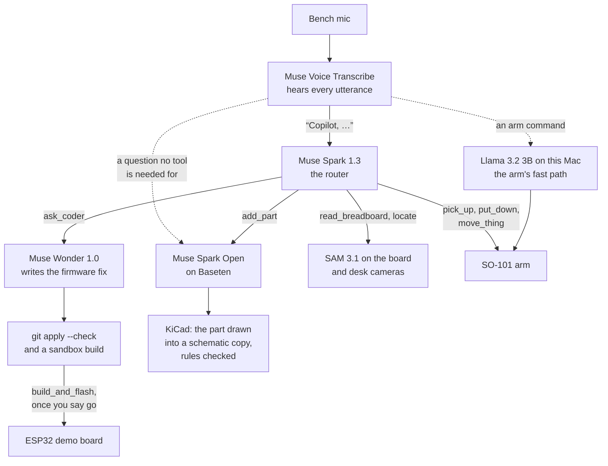
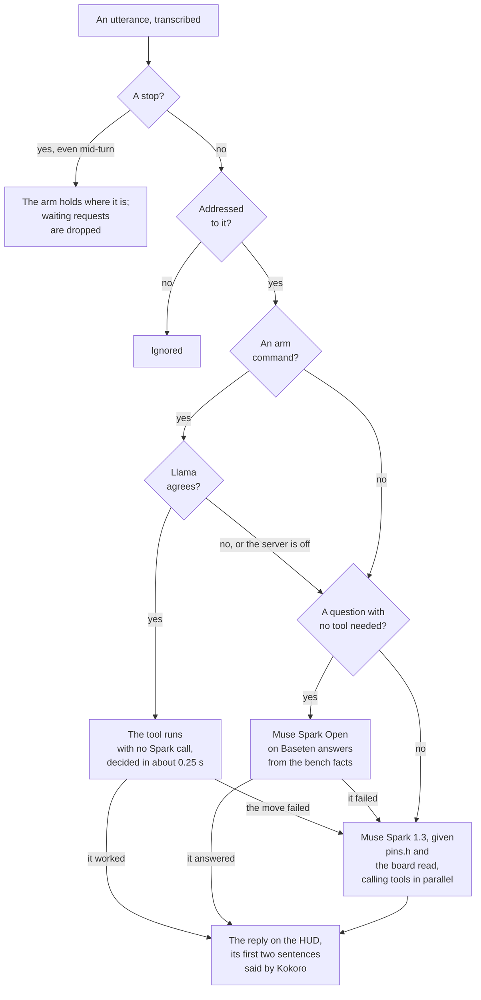
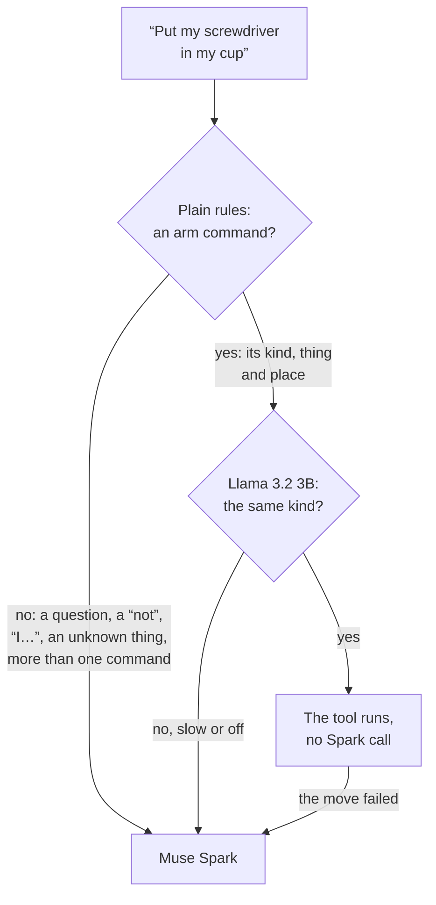

# Workbench Co-Pilot

[](https://github.com/raahimnawaz/workbench-copilot/actions/workflows/tests.yml)

An AI lab partner for the electronics bench. You talk to it hands free: say "Copilot," and your request. **Muse Spark** routes each request: **Muse Wonder** writes the firmware fix, **SAM 3.1** reads the breadboard and finds things on the desk, **Muse Voice Transcribe** hears you, and an **SO-101** arm picks things up and puts them away. Spoken arm commands run through a local **Llama 3.2 3B** fast path, and the HUD shows every model at work.

Debugging a circuit means turning away from the board to read code, check a pinout and fetch a tool, then finding your place again. The co-pilot keeps your hands and eyes on the bench: it looks at the wiring itself, fixes the firmware, draws new parts into the schematic and puts your tools away.

Built for the Meta Global AI Developer Hackathon (Indie track, Push the Frontier), Oct 26 – Nov 4, 2026.

| Result | How |
|---|---|
| **Up to 75% lower** API cost, and **about 90% less** time waiting on models | over the build, from sending Spark the whole conversation, gathering bench facts in code and moving arm commands on-device |
| **9 s** for Muse Wonder to write the LED fix and compile it | once Spark has found the miswired GPIO in a photo of the breadboard (median, video takes) |
| **0.25 s** for a spoken arm command, against 4.4 s through the cloud | a hybrid of plain rules and Llama 3.2 3B on this Mac, at no API cost |
| **0 wrong arm moves** on 117 unseen phrasings | the rules and Llama must agree; the model alone made 20, the rules alone 3 |
| **11 s** to learn a new part and wire it into the schematic | Muse Spark Open on Baseten, checked by KiCad's electrical rules (median, video takes) |
| **6 Meta models**, about **$0.06** a full demo | Muse Spark, Muse Wonder, Muse Spark Open, SAM 3.1, Muse Voice Transcribe and Llama 3.2 3B |

## Quick start

No hardware needed: `--sim` runs the real models against a recorded bench (about $0.025 a run on the Meta Model API).

```bash
git clone https://github.com/raahimnawaz/workbench-copilot && cd workbench-copilot
uv venv --python 3.12 && uv pip install -e '.[voice,dev]'
cp .env.example .env        # then add your META_API_KEY
echo "My LED isn't on. Check my wiring against the firmware." | .venv/bin/python -m wbc.agent --sim
```

[Setup](#setup-apple-silicon) and [Run](#run) cover the voice, the arm and the cameras.

## How it fits together



Every reply shows on the HUD, and Kokoro says it on this Mac. The dashed lines are the two routes that skip Spark; [how the router works](#how-the-router-works) gives the rules.

## Results

Over the build, API costs came down by up to 75%, and the time spent waiting on models by about 90%. The changes behind them:

- **The whole conversation in every Spark call,** instead of chaining calls on `previous_response_id`: a follow-up call went from 12–14 s to about 2 s.
- **Bench facts gathered by code, kept locally and sent up front.** Before Spark's first call of a turn, code fetches `pins.h` and the board read in parallel, so Spark doesn't spend a round asking for them. The board read is made once at start-up and kept for the session, so later turns pay for neither the photo nor SAM.
- **Arm commands on a local model.** Plain rules and Llama 3.2 3B on this Mac, with its prompt cache, take an arm command in about 0.25 s, against about 4.4 s through Spark, and cost nothing.
- **Work started before it's needed:** the coder's sandbox is warmed at start-up (the fix compiles in about 8 s, not 14 s), the desk camera stays open so a photo doesn't wait for it to settle, and the arm powers on during the photo. Tool calls in one round run in parallel.

### In the video's takes (Nov 4)

The whole scene on the real bench, by voice: "Why isn't my LED on?", then "Go. Also, put my screwdriver in my cup, and add my screen to my schematic." Times are each tool's own, from 29 takes.

| Step | Median | Range |
|---|---|---|
| Spark finds the wire on the wrong GPIO, Wonder writes the fix and it compiles in the sandbox (`ask_coder`) | 9.2 s | 2.8–13.1 s |
| Build and flash (`build_and_flash`) | 18.1 s | 12.9–25.0 s |
| Spark Open on Baseten learns the screen, and KiCad's rules check passes on the drawn copy (`add_part`) | 11.4 s | 7.4–30.3 s |
| The arm stands the screwdriver in the cup (`move_thing`) | 42.0 s | 38.9–46.7 s |

A take costs about $0.06 in API calls.

## Design notes

What each idea is, the research it lines up with, and what was measured. The papers are under [References](#references).

- **The Toolformer-style fine-tune** (`scripts/toolformer_*.py`): adapted from Meta's Toolformer [1], which teaches a model a tool from labels written for it, keeping only the calls that help. Here Spark writes spoken requests and labels each in the fast path's own prompt, and a label is kept only when it matches the intent it was written for and its call runs on the recorded bench, where Toolformer keeps a call when it lowers the model's loss. The student is Llama 3.2 3B [3] with a LoRA [13]. Measured: 351 of 390 labels kept, for $0.99; trained on Modal, the right tool on held-out requests went from 47 to 50 of 53. [The fast path's section](#the-arms-fast-path-rules-llama-and-a-toolformer-style-fine-tune) has the whole pipeline.
- **Reading the board with SAM:** SAM 3.1 [2] segments the wires from one noun phrase, and plain code does the rest: an AprilTag carrier [14] maps the photo to millimeters, so there's no camera calibration to keep, and the hole grid is fitted to the photo, searching 1.2 mm, 1° and a scale of 0.97–1.06 around the printed outline; a wire end snaps to a hole within 1.3 mm. Measured: live on the bench, it finds the demo's wire on the wrong GPIO with the line to fix.
- **The arm's fast path:** a cheap local model first and Spark as the fallback, an LLM cascade like FrugalGPT [7] and RouteLLM [8]. What's different: the arm moves only when two independent checks agree, plain rules and Llama 3.2 3B, and anything else goes to Spark. Measured: about 0.25 s from request to reply, against about 4.4 s through Spark; on 117 phrasings neither was tuned on, no wrong arm move, where the model alone made 20 and the rules alone 3.
- **Hiding dead time:** bench facts fetched before Spark's first call and kept for the session, tool calls in one round run in parallel, and a request that asks for an arm move and something else runs both at once, so Spark Open can work while the arm moves. The same idea as LLMCompiler's parallel function calling [9]. Measured: a follow-up Spark call went from 12–14 s to about 2 s, and the wait on models fell by about 90% over the build.
- **Memory recall:** rare-word weighting and a slow fade with age, the same as IDF [10] and BM25 [11] and DCG's log discount [12]; turns that changed the bench count more, as Generative Agents weighs importance beside recency and relevance [6]. So "where does my screwdriver go" finds the screwdriver's note, not the tweezers'.
- **Wonder fixing its own diff:** a diff that doesn't apply or compile goes back to Wonder once with the error and the build log, as in Reflexion's self-correction [5]. Measured: the LED's fix passes on the first try.
- **Every check before anything happens:** a diff must apply and build in a sandbox before it's staged, a flash waits for "go", and every pose of a pick and a put is solved before the first move. Moves are quintic, the minimum-jerk profile [15], and the IK is damped least squares [16]. Measured: 200 of 200 bench poses round-trip within 0.2 mm and 0.5°; after a move, each joint is re-aimed toward 0.2° of its target for up to three rounds.
- **A photo the read can trust:** each read measures its view's sharpness as the variance of the Laplacian [17] and how much glare blew out, and says what to change. Measured: good reads at 389–556 against a 150 warning.

## Built during the hackathon, and what it builds on

Everything in this repository was written during the hackathon, starting Oct 26, 2026, and the commit history dates every change. The exceptions are the vendored URDF and the two pieces of MIT-licensed code the HUD's page adapts, all listed below.

| Built here | What it does |
|---|---|
| `wbc/agent/` | The router loop on Muse Spark, its tools, `ask_coder` on Muse Wonder, the demo board's serial link, the voice front end (wake phrase, spoken stop, short answers), spoken replies, the budget guard and the console HUD |
| `wbc/agent/memory.py` | Sessions that survive a restart and a full context, and the `remember` / `recall` / `forget` notebook |
| `wbc/agent/fast_arm.py` | The arm's fast path: plain rules and a local Llama 3.2 3B have to agree on an arm command, which then runs with no Spark call |
| `scripts/toolformer_data.py`, `toolformer_train.py`, `toolformer_mlx.py` | Fine-tuning the fast path's Llama after Meta's Toolformer: Spark writes and labels spoken requests in the fast path's own format, a label is kept only when its call runs on the recorded bench, and a LoRA is trained on Modal and converted for `mlx_lm.server` |
| `hud/`, `wbc/agent/web_hud.py` | The HUD's orb page (canvas and WebGL, no packages) and its live feed over Server-Sent Events: the mic listening, each request, every model call with its time, the reply and its speech, and each turn's time and spend. `hud/CREDITS.md` lists what the page borrows |
| `wbc/motion/kinematics.py` | URDF chain loader, forward kinematics, damped least-squares IK, the (x, y, z, pitch, roll) grasp frame |
| `wbc/motion/joints.py`, `wbc/motion/trajectory.py` | Raw servo ticks to the URDF's joint angles, with signs checked by hand on the arm, and quintic moves timed under joint and tip speed caps |
| `wbc/motion/arm.py`, `wbc/motion/sts.py` | The arm driver, the one owner of the servo bus: power-on without a jump, moves in URDF angles, refusals before anything moves, every motor cut when a joint strays, re-aim, grip and release. And a small STS3215 client for the read-only tools |
| `wbc/motion/hand.py`, `wbc/motion/table.py` | Picking a thing up and putting it down: every pose solved before the first one moves, the fixed jaw beside the thing, and floors from the desk as the arm measured it |
| `wbc/motion/carrier.py`, `scripts/register_arm.py` | Registering the arm to the carrier from points touched with the motors off, and the touch test |
| `wbc/perception/` | The SAM 3.1 client, camera capture, the board reader (the carrier's tags, the top-down view, the hole grid fit, wire tracing, the netlist and its check against `pins.h`) and the desk camera's `locate` |
| `scripts/` | The smoke test, the board reader and its carrier sheet, the desk camera, the joint map check and arm registration |
| `wbc/perception/schematic.py`, `scripts/make_schematic.py`, `hardware/*.kicad_sch` | The demo boards' KiCad schematics, drawn from KiCad's own symbols, and `read_schematic`: their nets and KiCad's electrical rules check, through `kicad-cli` |
| `wbc/agent/parts.py` | `add_part`: Muse Spark Open teaches itself a part from `parts.yaml` (its wiring to the DevKit's free GPIOs, its library and setup code, saved as a skill in `.wbc/skills/`), and the part is drawn into a copy of the schematic in `.wbc/schematics/`, kept only if KiCad's electrical rules check passes, and shown in KiCad with `--show` |
| `scripts/kokoro_server.py`, `scripts/kokoro-say` | The co-pilot's voice: Kokoro-82M kept loaded on this Mac, and a stand-in for `say` that plays its audio |
| `config/`, `fixtures/`, `tests/` | Model, bench and arm config, the recorded bench for `--sim`, 908 offline tests |
| `firmware/dut_demo/` | The demo board: lights an LED, keeps it on and says so over serial |

| Reused | License | Used for |
|---|---|---|
| `hardware/so101_new_calib.urdf`, from [TheRobotStudio/SO-ARM100](https://github.com/TheRobotStudio/SO-ARM100) | Apache-2.0 | The arm's kinematic chain (unchanged copy) |
| [LeRobot](https://github.com/huggingface/lerobot) | Apache-2.0 | Servo calibration and the Feetech bus |
| The dot lattice from [thinking-orbs](https://github.com/Jakubantalik/thinking-orbs) | MIT | The orb's rings of dots in `hud/orb-light.html`, adapted to turn on the Siri line and ride our own waves (the notice is at the end of the page) |
| The bloom and sun rays from [WebGL-Fluid-Simulation](https://github.com/PavelDoGreat/WebGL-Fluid-Simulation) | MIT | The light streaming from the orb's dots in `hud/orb-light.html`, adapted to carry the dots' colors (the notice is at the end of the page) |
| Muse Spark, Muse Wonder, Muse Voice Transcribe, SAM 3.1 on the Meta Model API | Meta API terms | Routing, coding, speech, segmentation |
| [meta-sam-parser](https://pypi.org/project/meta-sam-parser/) 0.1, from Meta | SAM License | Reading SAM 3.1's replies: the token grammar and the mask codec (installed from PyPI, not vendored) |
| Llama 3.2 3B Instruct, 4-bit MLX (`mlx-community/Llama-3.2-3B-Instruct-4bit`), served by mlx-lm | Llama 3.2 Community License, and MIT for mlx-lm. **Built with Llama** | The arm's fast path: a second opinion on spoken arm commands, on this Mac |
| Llama 3.2 3B Instruct in full precision, from unsloth's ungated copy (`unsloth/Llama-3.2-3B-Instruct`) | Llama 3.2 Community License. **Built with Llama** | The base the Toolformer-style fine-tune trains its LoRA on (`scripts/toolformer_train.py`) |
| PyTorch, Hugging Face Transformers, PEFT, Accelerate and safetensors | BSD-3-Clause; Apache-2.0 for the other four | The fine-tune on Modal, and turning its adapter into one `mlx_lm.server` loads |
| [Modal](https://modal.com) and its Python client | Modal's terms; the client Apache-2.0 | The A10G the fine-tune runs on (`pip install -e '.[train]'`) |
| [AprilTag](https://april.eecs.umich.edu/software/apriltag)'s tag36h11 family, as built into OpenCV's ArUco module | BSD-2-Clause | The carrier's and the desk's tags |
| [Kokoro-82M](https://huggingface.co/hexgrad/Kokoro-82M) weights, run by [kokoro-onnx](https://github.com/thewh1teagle/kokoro-onnx) with onnxruntime and espeak-ng (through espeakng-loader and phonemizer) | Apache-2.0; MIT; MIT; GPL-3.0 (espeak-ng, phonemizer) | The co-pilot's voice (Meta's API has no text-to-speech model), in its own venv: `pip install kokoro-onnx==0.6.1` |
| [Visual Studio Code](https://code.visualstudio.com)'s `code` command | Microsoft's product license | `--show` opens `pins.h` as Wonder's fix lands in it, and the skill `add_part` saves |
| macOS `say` | Part of macOS | The voice only when `mouth.command` is unset: its voices can't be in a published video |
| [KiCad](https://www.kicad.org) 10 and its symbol libraries | GPL-3.0; CC-BY-SA-4.0 with KiCad's exception for designs | `kicad-cli` exports the schematics' netlists and runs their electrical rules checks; the symbols are drawn into `hardware/*.kicad_sch` |
| Muse Spark Open (`meta-models/muse-spark-open-1026`) on [Baseten](https://www.baseten.co) | Meta's open weights, served by Baseten | Questions no tool is needed for (`open` in `models.yaml`) |
| openai, numpy, PyYAML, httpx, sounddevice, pyserial, pytest, OpenCV, Pillow | Apache-2.0, BSD-3, MIT, BSD-3, MIT, BSD-3, MIT, Apache-2.0, MIT-CMU | Python dependencies |
| [PlatformIO](https://platformio.org) and the [Arduino core for ESP32](https://github.com/espressif/arduino-esp32) | Apache-2.0, LGPL-2.1 | Building and flashing the demo board's firmware |

## What runs live

Each piece runs with the real models, and the arm, the cameras and the demo board on the real bench.

| Piece | What it does |
|---|---|
| The LED fix | Reads the breadboard, finds the wire on the wrong GPIO against `pins.h`, has Wonder write and compile the fix, and flashes it on "go" |
| Router on Muse Spark | Routes each request in about 2 s a call, calling tools in parallel |
| Voice | Hands-free on the bench mic, every utterance transcribed by Muse Voice Transcribe; replies spoken by Kokoro-82M on the Mac in under a second |
| Arm fast path | Spoken arm commands decided on the Mac in about 0.25 s, by rules and Llama 3.2 3B agreeing |
| Picks and puts | "Put my screwdriver on my sticky note" in 31.5 s; "put my screwdriver in my cup" stands it in the mug on end |
| Board reader | Traces every flat jumper to its holes, builds the netlist and checks it against the firmware |
| Desk camera | Finds a named thing on the desk and places it in the arm's frame |
| Add a part | Spark Open on Baseten wires a new part to free GPIOs, saves it as a skill and draws it into the KiCad schematic, rules-checked |
| Spark Open | Answers questions no tool is needed for from the bench facts, in about 7 s |
| Memory | Picks up an earlier session and recalls where things go from notes |
| Kinematics | 200 of 200 bench poses round-trip within 0.2 mm and 0.5° |
| Budget guard | Every paid call checks tracked spend first |

## Hardware

| Part | Role |
|---|---|
| SO-101 arm, six Feetech STS3215 servos (a 1/345 elbow) on a 1 Mbps bus | picks things up and puts them away |
| ESP32 DevKit (30-pin DOIT) on a breadboard, an LED and 330 Ω | the demo board the co-pilot debugs and flashes |
| Two Logitech C920 webcams | one over the breadboard, one 71 cm over the desk |
| Printed AprilTag sheets (tag36h11) | map each photo to millimeters and the desk to the arm's frame |
| Razer Seiren Mini microphone | hands-free voice |
| A Mac with Apple Silicon | runs the agent, Llama 3.2 3B, the Kokoro voice and KiCad |
| SSD1306 0.96" OLED screen | the part the co-pilot teaches itself to add |

## Setup (Apple Silicon)

```bash
uv venv --python 3.12 && source .venv/bin/activate
uv pip install -e '.[voice,dev]'
cp .env.example .env        # then put your META_API_KEY in .env
pytest
python scripts/smoke_test.py
```

The smoke test makes one small call to each hosted model and reports which model ids your key can see. Run it before anything else. The arm needs the `arm` and `lerobot` extras, the cameras `eyes`, and flashing the demo board `firmware`.

## Run

```bash
python -m wbc.agent --sim
```

Then type `My LED isn't on. Check my wiring against the firmware.` With `--sim`, `read_breadboard` returns the recorded LED scene from `fixtures/`, and `build_and_flash` pretends. That runs the real router and the real Wonder coder with no hardware attached.

- `--voice` also listens on the bench mic (`ears.input_device`). Say "Copilot," and your request, or "Copilot." and then the request. Every utterance is transcribed, and only the ones addressed to the co-pilot go to the router. After a reply that asks something, a short answer such as "Yes." or "Go." needs no "Copilot," for 8 s. `--hear` is a mic check: it prints what it heard and routes nothing. The first time, macOS asks to let your terminal use the microphone.
- With `--voice`, replies are said out loud: the first sentence or two of each, while the HUD shows all of it. The mic drops what it hears while the co-pilot speaks, so it never answers itself. `--no-speak` keeps replies on the HUD, and `--speak` says them without `--voice`. The voice is Kokoro-82M on this Mac: install it in a venv of its own with a short path (`python3 -m venv ~/kokoro-venv && ~/kokoro-venv/bin/pip install kokoro-onnx==0.6.1`), and leave `~/kokoro-venv/bin/python -I scripts/kokoro_server.py` running (`--models` names the folder with kokoro-onnx's v1.0 model files). `mouth:` in `config/models.yaml` picks the voice (the server's `/voices` lists them).
- `--hud` shows each turn live on the HUD's orb page: open <http://127.0.0.1:8766/> in Chrome (`--hud 8800` picks another port). `hud/README.md` has the details.
- `--show`, for a take on macOS, opens the HUD (with `--hud`) as a Chrome app window of its own, with no tabs or address bar, and the board's schematic in KiCad's Schematic Editor. The window closes when the agent ends (`wbc/agent/show.py`).
- For a recorded take, a few switches cut the dead air, all off by default: `hand.idle_at_start` in `config/robot.yaml` (the arm waits in its idle pose from the start), and in `config/models.yaml` `ears.every_utterance` (no wake phrase, with `ears.hangover_s` 1.4 so a slow question isn't cut in two) and a `take:` section with `warm_at_start` (one tiny call to each model), `alongside` (an arm command runs while another turn does) and `lanes` (a "go" to an offered flash, adding the screen and arm commands run together, with no planning call to Spark).
- `--arm` lets the arm's tools move it. With `hand.go_ahead: request` in `config/robot.yaml`, your request is the go-ahead and the arm moves at once. "Copilot, stop", or "Stop!" on its own, goes straight from the ears to the arm, even mid-turn: it holds where it is with its motors on, and the requests waiting behind it are dropped. `--enter` makes each move wait for Enter at the keyboard, for bench tests. Ctrl-C cuts every motor and the arm drops, so keep a hand near it. `--no-prefetch` skips the board checks (the board read and `pins.h`) in a session that only moves the arm.
- Arm commands can skip Spark. Serve Llama 3.2 3B on this Mac in its own venv: `pip install mlx-lm==0.32.2`, then `mlx_lm.server --model mlx-community/Llama-3.2-3B-Instruct-4bit --port 8090 --prompt-cache-bytes 536870912` (the first run downloads 1.8 GB). While it runs, a request naming a thing and a place the rules know (`fast_arm:` in `config/models.yaml`) runs at once if Llama agrees on the kind of command, and the result is said when the move is done. Everything else goes to Spark with no extra wait. `--no-fast-arm` sends everything to Spark, to compare.
- Every turn is recorded in `.wbc/session.json`, however it ends. Each run starts a new session; `--resume` picks up the last one, and `--sim` keeps its own. A conversation that grows too long, or fails twice in a row, becomes a summary that the next one starts from, and code never runs a tool twice: after a tool has run, it asks what's still to do. The turns a summary folds away are kept, and a request that mentions one brings it back whole, with the exchange around it, in that turn's own message, so "which pin was the LED on earlier?" finds the turn that said so while the instructions stay the same from turn to turn. Matches are scored by BM25 (a rare word counts most, whole words only, evened out for length), by age at 1 / ln(e + age) for up to half, so an old match fades slowly instead of falling off, and by what the turn did: one that changed the bench counts 1.5 times talk. Past the newest 20 notes, an old note the request is about reaches its turn the same way. Spark Open sees the last six turns, so a question can refer back to them.
- The router keeps a notebook in `.wbc/notebook.jsonl` with its `remember`, `recall` and `forget` tools, and the newest 20 notes go into every call. A note can say where a thing goes on the desk, with the short name `locate` should look for in quotes (the screwdriver goes on the "sticky note"), so "put the screwdriver away" works in a later session. A note never moves the arm by itself.

## How the router works

Every utterance is transcribed, and each one takes the first path that fits:



- **A stop** is "Copilot, stop", or "Stop!" on its own. It's heard while a turn runs and while the co-pilot speaks, and goes straight to `Bench.halt()`.
- **Addressed to it** means it starts with "Copilot", or answers the co-pilot's question in up to five words within 8 s.
- **An arm command** is found by plain rules (`wbc/agent/fast_arm.py`): its kind from trigger words, its thing and place from `fast_arm` in `config/models.yaml` or a note's quoted place. Questions, a "not", "I" and "we" statements, a bare "that" and unknown things aren't, and neither is a request with more than one command in it ("…and add my screen", "…then go home", two things named): that goes to Spark whole, which runs every part. Llama 3.2 3B on `mlx_lm.server` then has to name the same kind of command.
- **A question with no tool needed** starts with "what", "how", "is" and the like, and has none of "why", "fix", "flash", "move" and the rest, nor anything only the cameras, the arm, the notebook, the spend or the conversation can answer ("where", "holding", "cup", "earlier", "spent"…), nor a go-ahead such as "do it". When the bench facts don't answer it after all, Spark Open replies PASS and Spark takes it; a question to Baseten that stalls gives up after 20 s, with no retry, and Spark takes it too. `add_part` waits up to 180 s for Spark Open's longer reasoning.

Once a request reaches Muse Spark, it decides what runs, and every other model sits behind a tool:

- Before Spark's first call of a turn, code fetches the bench facts it will need (`router.prefetch`): `pins.h` and the board read, which is made once at start-up and kept for the session. The schematic isn't among them, since it would give the LED's fix away; Spark calls `read_schematic` when the design is asked about. Spark calls `read_breadboard` itself when you say the wiring changed.
- `ask_coder` sends a task, the bench facts and up to 4 files to Muse Wonder. The diff it returns must pass `git apply --check` and a PlatformIO build in a sandbox copy, and then it's staged in the working tree, never committed. A diff that fails either check goes back to Wonder once with the error and the build log, inside the same call, so Spark doesn't spend a round asking again. `build_and_flash` uploads it to the demo board once you say go, and Spark asks whether the LED is on.
- Tool calls in one round run in parallel. Every model id and price lives in `config/models.yaml`.
- **Budget stop:** every paid call checks tracked spend first. Nothing more goes out once it reaches `budget.limit_usd` ($140, just under the $150 credit), and the HUD warns once past `budget.warn_usd` ($100). Tracked spend lives in `.wbc/spend.json` and uses the estimated prices in `models.yaml`. Calls made elsewhere aren't counted, so keep the spend alert on the Meta Billing page as the backstop.

## The arm's fast path: rules, Llama and a Toolformer-style fine-tune

A spoken arm command shouldn't wait on a cloud model. So arm commands take a hybrid path on this Mac (`wbc/agent/fast_arm.py`), where plain rules and a small local model each get a say, and the arm moves only when they agree:



- **The rules propose, the model can only veto.** The rules take the kind of command from its trigger words ("put", "pick up", "go home"), and the thing and the place from the names in `fast_arm:` in `config/models.yaml`, or, for "put it away", from the place a note gives it in quotes. Llama 3.2 3B, served by `mlx_lm.server` with its prompt cache, then reads the same request and must name the same kind of command. It never supplies a name, so it can't send the arm to something the rules didn't find, and a request the rules don't take costs no model call at all.
- **Measured on 117 phrasings neither was tuned on:** the model alone would have moved the arm wrongly 20 times, the rules alone 3 times (each now caught by a rule), and the two agreeing never; 49 of the 62 real commands ran locally. A command takes about 0.25 s from request to reply, against about 4.4 s through Spark, and costs nothing.

### Teaching the local model, after Toolformer

Meta's Toolformer [1] teaches a model to use tools from labels it writes itself, keeping only the calls that help. Here a large model teaches a small one, and a label is kept only when its call works on the bench:

1. **Spark writes the requests** (`scripts/toolformer_data.py`): varied spoken requests for 13 intents, arm commands on the recorded desk's screwdriver, tray and cup, and the things that only sound like them (questions, "I put…", "don't…", idioms, wiring requests).
2. **Spark labels each one exactly as the fast path asks Llama:** the same instructions (`fast_arm.SYSTEM`) and the same bench state.
3. **Only labels that work are kept.** A label must match the intent its request was written for, and an arm call must run on the recorded bench (`--sim`): a `put_down` labeled while nothing is held fails there and is dropped. Toolformer keeps a call when it lowers the model's loss; this keeps one when it executes. Every phrasing the benchmark tests is left out, so the evaluation stays unseen.
4. **A LoRA on Modal** (`scripts/toolformer_train.py`): rank 8, alpha 16, on every layer's `q_proj` and `v_proj` [13], the loss on the answer only, 3 epochs at 2e-4 on one A10G, from Llama 3.2 3B Instruct.
5. **Back on this Mac** (`scripts/toolformer_mlx.py`): PEFT's adapter is transposed and renamed into the layout `mlx_lm.server` loads with `--adapter-path`, over the 4-bit model the fast path serves.

| Measured (Nov 3) | Result |
|---|---|
| Labels kept | 351 of 390, for $0.99 of Spark; 298 to train on and 53 held out |
| Right tool on the 53 held out (bf16, on Modal) | 47 before, 50 after |
| A fast-path answer on the 4-bit model, with the adapter | 0.18 s at the median |

The fast path serves the base model by default; the adapter loads on top of it with `--adapter-path`:

```bash
.venv/bin/python scripts/toolformer_data.py --exclude <benchmark phrasings>   # about $1: .wbc/toolformer/train.jsonl, valid.jsonl, labels.jsonl
.venv/bin/modal setup && .venv/bin/modal run scripts/toolformer_train.py   # under $1 on Modal: .wbc/toolformer/adapter-peft
.venv/bin/python scripts/toolformer_mlx.py                                   # free: .wbc/toolformer/adapter-mlx
mlx_lm.server --model mlx-community/Llama-3.2-3B-Instruct-4bit --adapter-path .wbc/toolformer/adapter-mlx --port 8090
```

## Reading the breadboard

`read_breadboard` turns one photo into each jumper's two holes, the netlist, and every place it disagrees with `pins.h`:

1. **Tags.** The breadboard lies on a printed carrier sheet with four AprilTags (tag36h11, ids 10–13, 20 mm). Their corners map the photo onto the sheet in millimeters, so a bumped camera or a refocus doesn't move the hole grid, and there's no camera calibration to keep.
2. **Top-down view.** Code cuts out the board area at 5.5 px/mm, about 970 × 360 px. That's under the 1008 px SAM works at, so thin wires keep their detail, and SAM's masks come back in board millimeters.
3. **SAM 3.1 and the hole grid.** SAM segments `wire` in the view: one plain noun per request, since "jumper wire" matches nothing. Meanwhile code finds where the board really lies: it shifts, turns and scales the hole grid, within half a pitch, until the predicted holes sit on the darkest spots. The board's top stands about 10 mm above the sheet, so the camera sees it about 2% larger than life, and only the right scale lines up all 63 rows.
4. **Wires.** Each mask is thinned to its center line and followed out to both tips. Each tip snaps to the nearest hole within 1.3 mm, and a tip farther from every hole is flagged.
5. **Netlist and `pins.h`.** Each row's a–e and f–j strips and each rail is a node, wires join nodes, and the ESP32's and the LED's pins sit in holes given in `config/bench.yaml`. Plain code follows each `pins.h` signal from its part's pin to the GPIO its net reaches, and reports any mismatch, its wire and hole, and the line to fix.

**The demo board** is an ESP32 DevKit lighting an LED: one jumper from the DevKit's header to a row, 330 Ω from that row to the LED's anode, and the LED's cathode to ground. The DevKit straddles the center channel, which leaves only column a free beside its pins, so the board carries one signal wire. Its firmware keeps the LED on and says `led on` over serial: watch it with `.venv/bin/pio device monitor -b 115200`. A force sensor board on the same jumper (`hardware/demo_sensor.kicad_sch`) is what `read_sensor` reads. The reader reads flat pre-cut jumpers: loose leads stand about 15 mm off the board, and their tips look up to 4 mm from where they go in.

```bash
python scripts/make_carrier.py          # .wbc/vision/carrier.pdf: print at 100%, check the 100 mm bar
python scripts/read_board.py cameras    # free: which cameras macOS and OpenCV see
python scripts/read_board.py check      # free: the tags, and the fitted hole grid drawn over the board
python scripts/read_board.py read       # $0.0025: the whole read, drawn in .wbc/vision/board-<time>.png
```

- Run them from Terminal.app, which macOS lets use the camera. Each takes a still from the camera in `bench.yaml`, or reads one with `--photo`. The C920 refocuses every time it's opened, so the capture waits 1.5 s, then keeps the sharpest of the next 1.5 s of frames.
- `config/bench.yaml` holds the camera, the carrier's tags, each board's place on the sheet, where each module's headers start, and which part pin each `pins.h` signal drives. `config/parts.yaml` holds the breadboard's geometry and the module pinouts. Change those and print the carrier again; never edit the sheet.
- Each read checks its own photo: a blurred top-down view (sharpness under 150, where good reads measured 389–556) or glare that blows out more than 1% of it is said among the read's problems, with what to change ("move the lamp"), and the read goes ahead.
- Each read saves the drawing, the top-down view and the result, with SAM's whole reply, as `.wbc/vision/board-<time>.*`.

## Finding things on the desk

A second C920 looks straight down at the desk from about 71 cm and sees the arm's whole reach, about 97 × 55 cm at 0.5 mm per pixel. `wbc/perception/desk.py` turns what it sees into the arm's frame, so the co-pilot can find "the cup" or "the screwdriver" and know where it is.

1. **Tags, touched once.** AprilTags (tag36h11, ids 20–25, 50 mm) lie flat around the arm's reach. The carrier's 20 mm tags can be touched too, so the arm over a few of the desk's still leaves enough in view. With the motors off, you put the gripper's tips on each tag's center, and forward kinematics records where it is in the arm's frame. Every photo is mapped through the tags it shows, so a bumped camera changes nothing.
2. **Top-down view and SAM 3.1.** Code cuts out the table around the arm at 1 px/mm and asks SAM for the thing by name.
3. **Height.** Something standing up looks further from the point under the camera than it is. The tags also place the camera itself, so given a thing's height, its outline's near and far edges put its middle back where it is: a cup's middle lands within 3 mm.

```bash
python scripts/desk_camera.py tags                                    # .wbc/vision/desk-tags.pdf: print at 100%
python scripts/desk_camera.py --port /dev/cu.usbmodemXXXX touch       # motors off: touch each tag's center
python scripts/desk_camera.py check                                   # free: how well the tags agree
python scripts/desk_camera.py table                                   # free: the desk's height under the arm, from the touches
python scripts/desk_camera.py locate cup --height 95                  # $0.0025: where the cup is in the arm's frame
```

`config/desk.yaml` holds the camera, the tags, the area SAM sees and the focal length used to place the camera.

## The arm

`wbc/motion/arm.py` is the driver, and the only code that talks to the servo bus while the agent runs. `Arm.open()` connects LeRobot's bus and nothing more: never `robot.connect()`, which can recalibrate the arm and always ends by turning torque on. `power_on()` brings the joints up one at a time from the base out, and `move_to(q)` moves all five together to URDF angles q.

- **Refused before anything moves:** a joint past an end of its calibrated range, the wrist roll near where its reading wraps, a servo at 65 °C, a target within 2° of a range's end, and a path that takes the jaw tips under their floor or the elbow and wrist axes under 30 mm above the desk. A refusal says which joint and which way to turn it.
- **Speed:** moves are quintic and peak at 45°/s on any joint and 180 mm/s at the jaw tips, and no goal goes more than 5° from where its joint is. Torque is capped at 50% on the arm joints and on the gripper (LeRobot's own ceiling for it; the gripper's overload threshold, which LeRobot sets to 25%, goes to 60% while it's powered, or a 50% squeeze would drop to 20% after 2 s), and a P of 32 on every joint but the wrist roll goes back on after LeRobot's setup at every power-on.
- **Cuts:** every motor is cut at once if a joint jumps 3° as its torque comes on, strays 5° from its goal during a move, sags 5 mm under a floor, or the bus fails. `cut()` works from any thread or a signal handler, every cut is read back servo by servo, and a cut latches until `clear_stop()`. `halt()`, the spoken stop, stops a move at its next tick and holds the arm there with its motors on.
- **Re-aim:** each joint stops short of its goal by its load over its P gain, so after a move's path `move_to()` sets each goal past its target by the shortfall, under the same caps and checks, until every joint is within 0.2°.
- **Gripper:** `grip()` closes on what's between the jaws and keeps squeezing under the cap, and says whether they stopped on something. `release()` opens them, stopping where something's in the way.

`wbc/motion/hand.py` builds the agent's arm skills on the driver. A pick goes straight down beside a thing's grip, 1 cm from its middle toward its narrow end (on a screwdriver, the handle near where it balances), with the jaws closing across its long axis, the fixed jaw beside it and the moving jaw closing it against the fixed one: over it, open only as wide as it needs, just over its top, down, grip, and back up. These jaws hold a handle in the gap above their tips, reading as shut as empty ones, so a pick goes back up either way and says when it can't tell. A put lines what's held up with the place's long axis, goes down to just over its top, opens as wide as the pick did, and closes the jaws again back up. A put into a container (`hand.containers` in `config/robot.yaml`, with its measured height) stands what's held in on end instead: lifted with the jaws turned across the arm, so turning the gripper up stands it on end over the opening, its narrow end first where the wrist roll can turn it that way, then down until that end is 15 mm inside the rim, and let go. The gripper reaches level low enough from about 25–28 cm out. Every pose a pick or a put needs is solved before the first one moves, so one the arm can't reach is refused with the arm where it was. Heights come from the desk as the arm's touches measured it (`wbc/motion/table.py`). Between requests, empty-handed, the arm waits in an idle pose with its motors on: the L pose with the gripper pointing straight down (`hand.idle_deg` in `config/robot.yaml`). The end of a session takes it back to where it sat when its motors came on, since the L pose can't hold itself up unpowered, and then the motors go off.

```bash
python scripts/check_joint_map.py --port /dev/cu.usbmodemXXXX check   # motors off: the joint map's signs, by hand
python scripts/register_arm.py --port /dev/cu.usbmodemXXXX touch       # motors off: register the arm to the carrier
```

- The joint map is q = sign · (raw − 2047) · 2π / 4096, with every sign +1: lerobot-calibrate's L pose is the URDF's zero. `check_joint_map.py` repeats the hand test, so run it again after a recalibration or a servo swap. It only reads, and won't run with a motor on.
- Keep to one program per serial port: LeRobot opens the port without locking it, so two would interleave their packets.
- In the URDF the gripper approaches along its z-axis, and `config/robot.yaml` turns the tool frame so the approach is x and the tool point is the closed jaws' tips.

## After the hackathon

- **12 V servos.** The SO-101 runs on 7.4 V STS3215s. From the URDF's link masses, reaching all the way out with 50 g held takes about 1.06 N·m at the shoulder lift, around or past the 50% torque cap on these servos, so a move out there can end in a sag cut instead of being refused up front. The 12 V STS3215 has about half again the torque. All six servos change together, with a 12 V supply and a new calibration: the current ones must never see 12 V (the shoulder lift's limit is 8.0 V).
- **Gravity-aware planning.** The same masses give each joint's gravity torque in any pose. Calibrated against the servos' own load readings, they would refuse a pose a joint can't hold before anything moves, and aim each joint past its target by its predicted sag, so a move needs fewer re-aim rounds.
- **Toolformer for every route.** After Meta's Toolformer, the local Llama learns from tool-call labels a model writes, kept only when the call runs, first for the fast path's arm commands, then for every route: whether a request needs a tool at all, which one, and when Spark Open can answer, replacing the word rules that pick a route today.
- **V-JEPA 2.** Meta's video world model, in two steps. First, its encoder on the desk camera's clip of a grip, telling a held thing from closed jaws, which the servos can't. Then its action-conditioned planner, trained on recorded runs of this arm, for moves the IK can't plan, such as turning a thing over before a put.
- **Skills it writes and keeps.** `add_part` saves what Spark Open works out about a part, but nothing reads it back yet: next it reuses a saved skill whose checks still pass. Then motion skills: a named routine of the arm's own moves, saved as data, every pose solved before it's saved and before each run.
- **Reinforcement learning, in simulation and then on the arm.** The URDF already carries every link's mass and inertia, so the arm can be simulated (MuJoCo, say) and policies trained there for what the written skills do least well: grasping odd shapes, standing a thing in the cup, recovering from a slip. Randomizing the desk, the lighting and the masses in simulation [18] is what lets a policy carry over to the real arm, where it would fine-tune on real runs with the reward read from the desk camera (SAM finding the thing where it should be), every action still under the driver's speed and torque caps and its cuts.
- **ROS 2.** Each skill as its own node, with actions for long moves (progress, and cancelling for the spoken stop), rosbag logs, tf2 for the camera and arm frames, and MoveIt's collision checks. The driver stays the bus's one owner.

## References

Meta's research first.

1. T. Schick, J. Dwivedi-Yu, R. Dessì, R. Raileanu, M. Lomeli, L. Zettlemoyer, N. Cancedda and T. Scialom. *Toolformer: Language Models Can Teach Themselves to Use Tools.* NeurIPS 2023. [arXiv:2302.04761](https://arxiv.org/abs/2302.04761)
2. A. Kirillov et al. *Segment Anything.* ICCV 2023. [arXiv:2304.02643](https://arxiv.org/abs/2304.02643). And Meta's *SAM 3: Segment Anything with Concepts*, 2025, which SAM 3.1 builds on.
3. Llama Team, AI @ Meta. *The Llama 3 Herd of Models.* 2024. [arXiv:2407.21783](https://arxiv.org/abs/2407.21783)
4. M. Assran et al. *V-JEPA 2: Self-Supervised Video Models Enable Understanding, Prediction and Planning.* 2025. [arXiv:2506.09985](https://arxiv.org/abs/2506.09985). Future work: see [After the hackathon](#after-the-hackathon).
5. N. Shinn, F. Cassano, A. Gopinath, K. Narasimhan and S. Yao. *Reflexion: Language Agents with Verbal Reinforcement Learning.* NeurIPS 2023. [arXiv:2303.11366](https://arxiv.org/abs/2303.11366)
6. J. S. Park, J. C. O'Brien, C. J. Cai, M. R. Morris, P. Liang and M. S. Bernstein. *Generative Agents: Interactive Simulacra of Human Behavior.* UIST 2023. [arXiv:2304.03442](https://arxiv.org/abs/2304.03442)
7. L. Chen, M. Zaharia and J. Zou. *FrugalGPT: How to Use Large Language Models While Reducing Cost and Improving Performance.* 2023. [arXiv:2305.05176](https://arxiv.org/abs/2305.05176)
8. I. Ong, A. Almahairi, V. Wu, W.-L. Chiang, T. Wu, J. E. Gonzalez, M. W. Kadous and I. Stoica. *RouteLLM: Learning to Route LLMs with Preference Data.* 2024. [arXiv:2406.18665](https://arxiv.org/abs/2406.18665)
9. S. Kim, S. Moon, R. Tabrizi, N. Lee, M. W. Mahoney, K. Keutzer and A. Gholami. *An LLM Compiler for Parallel Function Calling.* ICML 2024. [arXiv:2312.04511](https://arxiv.org/abs/2312.04511)
10. K. Spärck Jones. *A statistical interpretation of term specificity and its application in retrieval.* Journal of Documentation 28(1), 1972.
11. S. Robertson and H. Zaragoza. *The Probabilistic Relevance Framework: BM25 and Beyond.* Foundations and Trends in Information Retrieval 3(4), 2009.
12. K. Järvelin and J. Kekäläinen. *Cumulated gain-based evaluation of IR techniques.* ACM Transactions on Information Systems 20(4), 2002.
13. E. J. Hu et al. *LoRA: Low-Rank Adaptation of Large Language Models.* ICLR 2022. [arXiv:2106.09685](https://arxiv.org/abs/2106.09685)
14. E. Olson. *AprilTag: A robust and flexible visual fiducial system.* ICRA 2011.
15. T. Flash and N. Hogan. *The coordination of arm movements: an experimentally confirmed mathematical model.* Journal of Neuroscience 5(7), 1985.
16. Y. Nakamura and H. Hanafusa. *Inverse kinematic solutions with singularity robustness for robot manipulator control.* Journal of Dynamic Systems, Measurement, and Control 108(3), 1986.
17. J. L. Pech-Pacheco, G. Cristóbal, J. Chamorro-Martínez and J. Fernández-Valdivia. *Diatom autofocusing in brightfield microscopy: a comparative study.* ICPR 2000.
18. J. Tobin, R. Fong, A. Ray, J. Schneider, W. Zaremba and P. Abbeel. *Domain Randomization for Transferring Deep Neural Networks from Simulation to the Real World.* IROS 2017. [arXiv:1703.06907](https://arxiv.org/abs/1703.06907)

## Author

Raahim Nawaz ([@raahimnawaz](https://github.com/raahimnawaz)), for the Meta Global AI Developer Hackathon 2026.

## License

Apache-2.0: see [LICENSE](LICENSE). The reused pieces keep their own licenses, listed [above](#built-during-the-hackathon-and-what-it-builds-on).
