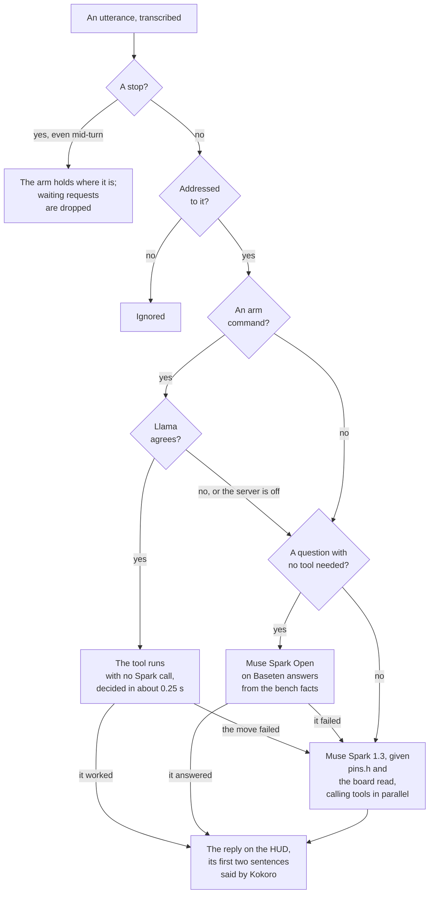
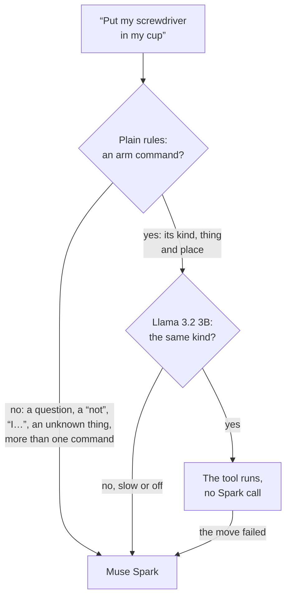

# The agent

How requests are routed between the models, and how spoken arm commands skip the cloud. Back to the [README](../README.md).

## How the router works

Every utterance is transcribed, and each one takes the first path that fits:



- **A stop** is "Copilot, stop", or "Stop!" on its own. It's heard while a turn runs and while the co-pilot speaks, and goes straight to `Bench.halt()`.
- **Addressed to it** means it starts with "Copilot", or answers the co-pilot's question in up to five words within 8 s.
- **An arm command** is found by plain rules (`wbc/agent/fast_arm.py`): its kind from trigger words, its thing and place from `fast_arm` in `config/models.yaml` or a note's quoted place. Questions, a "not", "I" and "we" statements, a bare "that" and unknown things aren't, and neither is a request with more than one command in it ("…and add my screen", "…then go home", two things named): that goes to Spark whole, which runs every part. Llama 3.2 3B on `mlx_lm.server` then has to name the same kind of command.
- **A question with no tool needed** starts with "what", "how", "is" and the like, and has none of "why", "fix", "flash", "move" and the rest, nor anything only the cameras, the arm, the notebook, the spend or the conversation can answer ("where", "holding", "cup", "earlier", "spent"…), nor a go-ahead such as "do it". When the bench facts don't answer it after all, Spark Open replies PASS and Spark takes it; a question to Baseten that stalls gives up after 20 s, with no retry, and Spark takes it too. `add_part` waits up to 180 s for Spark Open's longer reasoning.

Once a request reaches Muse Spark, it decides what runs, and every other model sits behind a tool:

- Before Spark's first call of a turn, code fetches the bench facts it will need (`router.prefetch`): `pins.h` and the board read, which is made once at start-up and kept for the session. The schematic isn't among them, since it would give the LED's fix away; Spark calls `read_schematic` when the design is asked about. Spark calls `read_breadboard` itself when you say the wiring changed.
- `ask_coder` sends a task, the bench facts and up to 4 files to Muse Wonder. The diff it returns must pass `git apply --check` and a PlatformIO build in a sandbox copy, and then it's staged in the working tree, never committed. A diff that fails either check goes back to Wonder once with the error and the build log, inside the same call, so Spark doesn't spend a round asking again. `build_and_flash` uploads it to the demo board once you say go, and Spark asks whether the LED is on.
- Tool calls in one round run in parallel. Every model id and price lives in `config/models.yaml`.
- **Budget stop:** every paid call checks tracked spend first. Nothing more goes out once it reaches `budget.limit_usd` ($140, just under the $150 credit), and the HUD warns once past `budget.warn_usd` ($100). Tracked spend lives in `.wbc/spend.json` and uses the estimated prices in `models.yaml`. Calls made elsewhere aren't counted, so keep the spend alert on the Meta Billing page as the backstop.

## The arm's fast path: rules, Llama and a Toolformer-style fine-tune

A spoken arm command shouldn't wait on a cloud model. So arm commands take a hybrid path on this Mac (`wbc/agent/fast_arm.py`), where plain rules and a small local model each get a say, and the arm moves only when they agree:



- **The rules propose, the model can only veto.** The rules take the kind of command from its trigger words ("put", "pick up", "go home"), and the thing and the place from the names in `fast_arm:` in `config/models.yaml`, or, for "put it away", from the place a note gives it in quotes. Llama 3.2 3B, served by `mlx_lm.server` with its prompt cache, then reads the same request and must name the same kind of command. It never supplies a name, so it can't send the arm to something the rules didn't find, and a request the rules don't take costs no model call at all.
- **Measured on 117 phrasings neither was tuned on:** the model alone would have moved the arm wrongly 20 times, the rules alone 3 times (each now caught by a rule), and the two agreeing never; 49 of the 62 real commands ran locally. A command takes about 0.25 s from request to reply, against about 4.4 s through Spark, and costs nothing.

### Teaching the local model, after Toolformer

Meta's Toolformer [1] teaches a model to use tools from labels it writes itself, keeping only the calls that help. Here a large model teaches a small one, and a label is kept only when its call works on the bench:

1. **Spark writes the requests** (`scripts/toolformer_data.py`): varied spoken requests for 13 intents, arm commands on the recorded desk's screwdriver, tray and cup, and the things that only sound like them (questions, "I put…", "don't…", idioms, wiring requests).
2. **Spark labels each one exactly as the fast path asks Llama:** the same instructions (`fast_arm.SYSTEM`) and the same bench state.
3. **Only labels that work are kept.** A label must match the intent its request was written for, and an arm call must run on the recorded bench (`--sim`): a `put_down` labeled while nothing is held fails there and is dropped. Toolformer keeps a call when it lowers the model's loss; this keeps one when it executes. Every phrasing the benchmark tests is left out, so the evaluation stays unseen.
4. **A LoRA on Modal** (`scripts/toolformer_train.py`): rank 8, alpha 16, on every layer's `q_proj` and `v_proj` [13], the loss on the answer only, 3 epochs at 2e-4 on one A10G, from Llama 3.2 3B Instruct.
5. **Back on this Mac** (`scripts/toolformer_mlx.py`): PEFT's adapter is transposed and renamed into the layout `mlx_lm.server` loads with `--adapter-path`, over the 4-bit model the fast path serves.

| Measured (Nov 3) | Result |
|---|---|
| Labels kept | 351 of 390, for $0.99 of Spark; 298 to train on and 53 held out |
| Right tool on the 53 held out (bf16, on Modal) | 47 before, 50 after |
| A fast-path answer on the 4-bit model, with the adapter | 0.18 s at the median |

The fast path serves the base model by default; the adapter loads on top of it with `--adapter-path`:

```bash
.venv/bin/python scripts/toolformer_data.py --exclude <benchmark phrasings>   # about $1: .wbc/toolformer/train.jsonl, valid.jsonl, labels.jsonl
.venv/bin/modal setup && .venv/bin/modal run scripts/toolformer_train.py   # under $1 on Modal: .wbc/toolformer/adapter-peft
.venv/bin/python scripts/toolformer_mlx.py                                   # free: .wbc/toolformer/adapter-mlx
mlx_lm.server --model mlx-community/Llama-3.2-3B-Instruct-4bit --adapter-path .wbc/toolformer/adapter-mlx --port 8090
```
